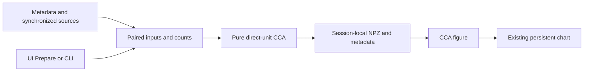

# Session Timeline PFC-HPC CCA: Implementation Plan and Live Handoff

Status: Implementation and designated-session validation complete, 2026-11-13.
CT026 2026-08-28 passed at 500/20 ms after synthetic/browser acceptance.
User inspection precedes any additional experimental sessions.
The [CCA spec](session_timeline_cca_spec_v1.md) owns the
confirmed science; this plan owns design, tests, delivery and assignments under
[AGENTS.md](../AGENTS.md) and [SoftwareDesign.md](SoftwareDesign.md).
New user decisions take precedence.

The handoff format follows the existing
[prediction plan](condition_prediction_generalization_implementation_plan.md#0-live-implementation-handoff)
and [synchrony plan](session_timeline_phase_synchrony_implementation_plan.md#0-live-implementation-handoff).
Keep current state here and append evidence below.

## 0. Live implementation handoff

### 0.1 Current snapshot

Update at assignment, RED/test-commit, GREEN/review, interruption, and data gates.

| Field | Current value |
| --- | --- |
| Observation | 2026-11-13; branch `refactor`; hover-fix HEAD `35c1481`. Recheck on resumption; this is not a reset target. |
| Authority | User approved implementation: "Begin implementation". WP1-WP7 authorized; WP8 designated CT026 2026-08-28 after synthetic/browser gates. |
| Feature state | WP1-WP8 technical work complete; CT026 500/20-ms fits, independent audits and actual saved displays passed. Usage guide complete. User inspection precedes wider batches. |
| Orchestrator | Current lead; owns this handoff, review, integration, and Git operations. Record actual runtime identity when available; do not infer it from historical plans. |
| Active worker / writable scope | `/root/cca_worker` idle, no writable scope. Orchestrator owns WP8 validation and final usage/handoff docs. |
| Existing work | Eleven pre-existing modified tracked files, including prediction/spec/view work, `src/main.py`, `src/neural_analysis/SESSION_TIMELINE.md`, and `src/neural_analysis/sync_ephys.py`; unrelated untracked files also exist. Preserve them. |
| Current feature files | Source committed through `35c1481`; final handoff/usage/README changes owned by orchestrator. No worker-owned pending changes. |
| Tests / processes | Lead combined 360 passed/one Node skip/18.12 s; final CCA/chart 164 passed/one Node skip/13.24 s; all CCA Ruff/whitespace passed. CT026 preview server78560 at loopback8527, IAB tab1 retained as deliverable; all analysis processes complete. |
| Experimental validation | User designated CT026 2026-08-28 after synthetic/browser gates; metadata path recorded below. No further session authorized. |
| Next action | User inspects CT026 outputs. No implementation task or additional experimental session is assigned. Preview command and results below support resumption. |

### 0.2 Work-package ledger

States: not started, RED, tests committed, GREEN pending review, accepted,
or waiting for a named external decision. Worker completion is not acceptance.

| Package | Planned owner | State / next gate | RED command, result, test commit | GREEN command, result, implementation commit, review |
| --- | --- | --- | --- | --- |
| WP0 spec/plan | Orchestrator | Approved / complete | Not applicable | Baseline 86 passed, 1 skipped; Section 9 |
| WP1 numerical CCA | Sole worker `/root/cca_worker` | Accepted | `ed25401`, rank-one `65b676f`; missing-module RED reproduced | `3166892`; lead 50 passed/0.77 s, worker 50 + 55 regressions, Ruff passed; source read |
| WP2 paired inputs/identity | Same worker | Accepted | `6592449`; missing-IO RED, lead 0.73 s | `a383bb4`; lead 36 passed/2.08 s; worker accumulated 154 passed; source/Ruff reviewed |
| WP3 persistence/discovery | Same worker | Accepted | `d599397`; review `41d6fbb`, four failures/1.46 s | `1203545`; lead 115 CCA passed/3.22 s, worker accumulated 171 passed; source/Ruff read |
| WP4 session/batch runners | Same worker | Accepted | `a1f7fd8`; missing-runner RED, lead 0.68 s | `64a9c11`; lead 22 passed/2.38 s, worker accumulated 193 passed/6.12 s; source/Ruff read |
| WP5 scientific figure | Same worker | Accepted | `f27c8e3`; lead missing-plotter 1.11 s; two actual benchmark failures 1.30 s | `c7cbafb`; lead 13 passed/5.75 s, worker accumulated 204 passed/10.34 s; source/Ruff read |
| WP6 app integration | Same worker | Accepted | `d7f4f0c`, `e689a92`, `51d637e`, `274614c` | `2a8a57c`; review fixes 13 passed/6.14 s; lead combined 360 passed/one Node skip/18.12 s |
| WP7 synthetic/browser/usage | Orchestrator; bounded same-worker fixes | Accepted; guide/README complete | `cb1b035`; hover regression `6514e5b` RED1.93 s | Browser pan/ranks/pair/hide-trace/start/Jump/20-ms bounds/hover passed; footer `bb12bfc`, hover `35c1481`; final CCA/chart164 passed/one skip |
| WP8 designated-session/performance | Orchestrator and user | Technical validation accepted; user inspection before batches | No new defect | Both fits/audits/browser passed; 696 common windows,141pairs; measured costs and paths below |

### 0.3 Resume procedure

1. Read the spec, this snapshot/ledger, the latest evidence entry, and repository
   rules. Confirm existing authorization instead of requesting it again.
2. Inspect actual branch/HEAD, staged/unstaged changes, and owned files. Preserve
   unrelated work. Stop for unexpected changes or uncertain ownership.
3. Check the recorded worker and live command/session before replacing either.
   Lost tool output is not proof that an agent or analysis process has stopped.
4. Resume the unfinished gate. Reproduce missing/interrupted or invalidated
   evidence; do not rerun every completed test or experimental preparation.
5. Before dispatch or interruption, update owner, phase, exact writable paths,
   last durable commit/product, live session/PID/log, and the next exact action.
   If interrupted during GREEN, retain the failing tests and partial source.

## 1. Scope and delivery boundaries

Deliver one separate **Session timeline and CCA** route. Fit ordinary direct-unit,
zero-lag, session-wide PFC-HPC CCA on the common complete choice windows, using
the existing `[-2,+2)` half-open windows and 500/100/50/20-ms bins. Preserve all
behavioral choices and real gaps. Retain all numerical pairs, with sample-SD-one
canonical scores and the agreed numerical-null handling.

The light-mode figure contains behavior, matched PFC/HPC heatmaps, one optional
overlaid trace row for a selected pair, and the existing session navigator.
Initially show the first ten available pairs and CC1 traces. Prepare/Recompute
are explicit; display controls consume saved products.

The scope excludes PCA prerequisites, condition residualization, within-window
fits, regularization, CV/shuffles/significance, local correlation tracks, and
LFP work. Six modules, small records, and local wiring suffice; no generic
framework, metadata-schema change, or new configuration file is needed.

## 2. Architecture, interfaces, and verified reuse

All names below are proposed project APIs, not assumed library functions.
New numerical functions document types, axes, units, and return values. Public
computational functions precede grouped local helpers. No new dependency.

| New module | Responsibility and planned interfaces |
| --- | --- |
| `population/cca.py` | Pure numerical records and functions: `RegionalCCATransform`, `PairedCCAFit`, `fit_paired_cca`, `transform_cca_activity`. No paths, widgets, or run flags. |
| `population/session_cca_io.py` | `PairedCCAInputs`, `SessionCCAResult`, and small `CCAResultInfo` headers; `load_cca_inputs`, `cca_configuration`, `save_cca_result`, `load_cca_result`, `discover_cca_results`. Own source identity, metadata-only discovery, and named-array persistence; call existing loaders. |
| `population/run_session_cca.py` | `run_session_cca` and CLI; compose input loading, fit, immutable output, log/summary/script copies, and `benchmark_cca_result`. Small run report, not full scores, returned to callers. |
| `population/run_session_cca_batch.py` | Session-list CLI and process-level dispatch to the single-session runner. Reuse existing list parsing and worker-count functions. |
| `population/cca_plotting.py` | `plot_session_cca` and a local window-geometry helper; consume saved records only. No fit, raw loading, or analysis writes. |
| `webapp/cca_view.py` | `render_session_cca_view`, cached saved loads, controls, explicit preparation, and result details. No duplicated numerical algorithm. |

Localized existing changes: `webapp/session_inputs.py` (route/availability),
`webapp/app.py` (early dispatch), neural README/timeline links, and a new short
`src/neural_analysis/SESSION_CCA.md` usage guide. Read callers before changing
any shared helper. Existing PCA and synchrony public interfaces stay intact.

Benchmark dependency: WP4 measures preparation, saved loading, bytes and memory.
WP5 adds figure/serialization measurements to the same benchmark helper after
its plotter tests are committed. No early plot implementation or fake measured
figure timings are needed to accept the runner package.



Verified reuse and limits:

- `load_timeline_behavior`, `prepare_timeline_choices`,
  `select_complete_choice_windows`, `choice_bin_edges`, `bin_choice_counts`,
  `select_timeline_population`, and `load_timeline_population` supply the
  existing clock, quality policy, coverage, and unsmoothed count contracts.
- Keep `population_quality="good_mua"` and `missing_label_policy="mua"`
  explicit, matching the PCA timeline. Do not silently adopt another view's
  strict-label default. A future policy change changes scientific identity.
- `add_timeline_behavior`, `session_time_bounds`, and
  `render_timeline_navigation` accept a behavior-only `SessionTimelineResult`.
  A narrow conversion with empty PCA regions reuses these helpers without
  putting CCA scores or invented variance fields into a PCA record.
- Reuse `render_timeline_chart` and its existing JavaScript unchanged initially.
  All proposed rows have elapsed-time x-axes, so no new pan callbacks are needed.
  Preserve stable component position/key and time/vertical revisions separately.
- PCA's heatmap builder requires variance fields and regional records; keep
  CCA geometry/hover local rather than broadening that public interface.
- `timeline_configuration` includes PCA-specific identity and version. Build a
  CCA identity from the public selection/source APIs; do not reuse that digest,
  call private compatibility helpers, or refactor the PCA cache system.
- Metadata resolution permits absent referenced raw files. Current generic
  availability can still reject missing behavior before route dispatch; WP6
  must add a CCA saved-result exception before that check. It must not require
  unrelated LFP, sites, or every probe's spike sources.

## 3. Records and numerical design

### 3.1 Data contracts

Let W be common complete choices, B bins/window, N = W x B, U_r input units,
P_r nonconstant units, and K = min(regional numerical ranks). Counts for both
regions share `(W,B)` axes; unit counts may differ. Reject empty/misaligned
axes, mismatched/duplicate IDs, and nonfinite data. Preparation also validates
the bin geometry against the selected width.

| Record / product | Required fields and meaning |
| --- | --- |
| `PairedCCAInputs` | Session ID/origin, choices/events, `(W,)` common choice positions, each region's coverage-eligible positions, `(B+1,)` relative-second edges, probe/unit IDs, count arrays `(W,B,U_r)`, source configuration. Counts per bin; UTC seconds retained. |
| `RegionalCCATransform` | Ordered input/retained/constant unit IDs, float64 `(U_r,)` count means/SDs, `(P_r,K)` coefficients in canonical-SD units per standardized unit, `(K,)` score offset, singular values, rank/cutoff. |
| `PairedCCAFit` | Two transforms; regional `(W,B,K)` float64 scores; ordered `(K,)` rho; fit observation count, diagnostics, joint signs, and fixed common color limit. |
| `SessionCCAResult` | Behavior/origin, eligibility/edges, optional paired fit, unavailable reason when no fit, and `meta`. No raw count duplication required in the saved result. |
| `CCAResultInfo` | Archive path, saved configuration, completion UTC and run ID; discovery reads these metadata fields without score arrays. |

The projection contract is:

```text
X = (counts[..., retained] - count_mean[retained]) / count_scale[retained]
Z = X @ coefficients - score_offset
```

Means/SDs are stored in input-unit order; `retained` selects the same P_r
columns from counts and preprocessing arrays. Projection requires the exact
fitted input-unit order. The offset is one saved session-level constant per
pair, preserving replay after library centering.

### 3.2 Estimator choice and rank adapter

Use installed `statsmodels.multivariate.cancorr.CanCorr` as the CCA estimator,
with a small NumPy/SciPy rank adapter. Its installed source was inspected:
construction fits immediately, `endog=HPC`, `exog=PFC`; results are `cancorr`,
`x_cancoef`, and `y_cancoef`. It centers inputs, returns unit-sum-square score
normalization, and rejects singular columns using an absolute tolerance.
Project with saved coefficients rather than assuming a package `transform`
API. Do not call `corr_test`.

Proposed algorithm:

1. Validate finite, nonnegative `(W,B,U_r)` counts and ordered unique IDs. Pool
   windows/bins identically. Calculate each unit's count mean and population SD
   (`ddof=0`); omit exactly constant units once across the common pool.
2. Standardize units. Compute a thin SVD for each region, keeping singular
   values strictly above `eps_float64 * max(matrix.shape) * largest_value`.
   This retains every numerically supported unit direction, without scientific
   PCA truncation. Save ranks/cutoffs; rank zero or N < 2 is unavailable.
3. Pass the retained left-singular-vector coordinates to
   `CanCorr(endog=Q_HPC, exog=Q_PFC, missing="raise", hasconst=False,
   tolerance=1e-8)`. Here Q denotes the regional retained observation basis,
   not the unit count. These coordinates have singular values near one; the
   package's absolute tolerance no longer discards low-variance unit directions.
   Installed statsmodels squeezes a one-column endog and then fails in CanCorr.
   If only HPC has rank one, swap the package input roles and map outputs back;
   if both ranks are one, use the complete scalar normalized-correlation case.
   Regression tests for signed/perfect/imperfect/zero scalar relations precede
   these narrow project-level workarounds; dependencies are unchanged.
4. Map the package coefficients back through each region's right singular
   vectors and inverse retained singular values. This is the minimum-norm map
   to all nonconstant original units. Initially multiply by `sqrt(N - 1)` to
   convert the package's score normalization. Minimum norm refers to the
   standardized-unit coordinates used for fitting.
5. Project original standardized activity. For each score column with mean m
   and sample SD s, divide its coefficients by s and save offset m/s. This folds
   residual normalization into the transform, giving mean-zero/sample-SD-one
   scores through the public projection function. Reject zero/nonfinite scales.
6. Keep all K pairs in descending correlation order. Apply the spec's joint sign
   convention to both regional coefficients, offsets, and scores. Compute the
   fixed common heatmap limit over both complete score arrays.

Validate this single estimator/adapter path in WP1. Its complete numerical-rank
basis satisfies direct-unit CCA without choosing a retained-PC count. Measure
its extra SVD work before considering a different implementation.

Numerical/input failures raise clear `ValueError` messages; the orchestration/UI
turn these into unavailable/error states without manufacturing a paired fit.

Proposed validation constants, saved with the numerical version: absolute
`1e-8` for score means and dimensionless covariance identities, projection
`rtol=1e-8, atol=1e-10` in canonical-score units, and `1e-10` for roundoff at
correlation bounds. The rank cutoff is the formula above, not `1e-8`.
Use `rtol=0` for identity/zero comparisons. WP1 must exercise these tolerances;
if they fail, review conditioning/algorithm before changing tolerances or tests.

Check sample covariance of each regional score matrix against identity and
cross-covariance against `diag(rho)`. Recompute empirical paired correlations
and compare to the package result; the package's internal clipping alone is
not sufficient evidence. Record maximum errors, retained conditioning, and
`max(0, rank_PFC + rank_HPC - (N - 1))` forced unit-correlation directions.
Rank saturation is descriptive and flagged, not silently regularized away.

Ties/zero correlations may have nonunique vectors. Test spectra and relevant
subspaces, not unique weights. If a retained near-null direction causes the
covariance/projection checks to fail, report numerical failure; do not silently
raise the rank cutoff, loosen tolerances, or introduce regularization.

## 4. Paired input, saved-result, and execution contracts

### Inputs and identity

WP2 reads current behavior and small quality/coverage metadata before loading
spike arrays. Intersect regional coverage positions in chronological choice
order, then bin exactly those choices for each region. Verify qualified unit
order, source row/trial/time identity, and exact shared bin edges. Use absolute
UTC tolerances with `rtol=0` where floating-point checks are necessary; default
relative comparisons on Unix timestamps are inappropriate.

CCA identity includes analysis/schema/numerical versions, session/probe roles,
selected units/channels, quality policies, bin/windows, zero-lag/common-pool/raw-
task policy, normalization/sign/rank parameters, and source path/size/mtime.
Sources are the trial table, optional events, and each selected probe's alignment
archive, spike assignments, cluster metadata and channel-quality file. Explicitly
record an absent optional event source. Record metadata path separately; unrelated
metadata or LFP fields and all display controls are excluded. Numerical changes
require an analysis/numerical version bump; record code/library versions too.

Do not silently change source sets between identity construction and fitting;
check their identities again before publication and fail clearly if changed.
This bounded check handles ordinary edits during preparation without a new
locking, hashing, or transaction framework.

### Saved versus fresh use

- Fresh Prepare/CLI validates current prerequisites/identity and reuses a matching
  completed fit unless rerun is explicit. Dry-run reads metadata/quality/coverage,
  loads no spike arrays, writes nothing, and returns nonzero if inputs are missing.
- Saved viewing selects actual saved session/probe/bin settings and stored
  behavior before raw-source checks. Missing raw files disable preparation but
  allow historical viewing with valid metadata; changed preparation widgets do
  not relabel that result. Test this copied-session path.
- Historical display does not establish compatibility with current sources:
  fresh preparation/reuse always verifies the current identity.

`session_cca_io.py` uses named arrays and dictionary `meta`, with
`analysis_version="session-timeline-cca-v1"`, schema version 1, and an explicit
numerical version. Store transform offsets as well as the spec's arrays. Save
both regions as one completed paired product. Discovery returns small metadata
headers; selected loading validates shapes, IDs, versions and paired-array
consistency without refitting. Order completed compatible candidates by stored
UTC completion time, then run ID and relative path as deterministic tie breaks.
If loading the newest candidate fails, warn and try the next compatible one;
ignore temporary/unsupported/metadata-corrupt files. No repeated decompression
of every score array during app availability checks. Only valid fits are
published; optional-fit records serve in-memory behavior-only/error presentation.

Use a unique timestamped `analysis_runs/session_timeline_cca_*` directory,
ordinary log/config/summary, and copies of main/batch scripts. Refuse experimental
outputs inside the source repository. Write the result through a temporary
sibling and rename only after success. Preserve failed-run logs and old results;
do not add a recovery service, global registry, or distributed locks.

The runner reports prepared/reused/dry-run, result path, identity and elapsed
seconds; input/fit failures raise a clear exception and the CLI exits nonzero.
Log parameters, counts, warnings/errors, timings and RSS. Batch dispatch uses
spawn processes, available cores capped by session count, and `--workers` for
RAM/I/O limits. Collect success/failure reports in session-list order, let other
sessions finish after one fails, and exit nonzero if any failed. Dry-run is
sequential with no pool. This CPU parallelism differs from the agent-worker
limit; UI preparation remains synchronous and explicit.

Proposed commands after implementation:

```bash
uv run -m src.neural_analysis.population.run_session_cca --session-metadata /path/to/neural_session.json --bin-width-ms 500 --dry-run
uv run -m src.neural_analysis.population.run_session_cca_batch --session-list /path/to/sessions.txt --bin-width-ms 500 --dry-run
```

Reuse `resolve_timeline_probe_roles`: version 3 supplies defaults, version 2
needs explicit `--pfc-probe` / `--hpc-probe`. Preparation requires two distinct
configured probes; a partial explicit selection does not silently fill the
other role from metadata. Keep `--rerun` and `--benchmark` consistent with PCA.
Incomplete selections still allow behavior-only navigation.

## 5. Figure and app behavior

WP5 consumes `SessionCCAResult` only. Combine shared behavior, two matched-rank
heatmaps, one optional two-color step row and the navigator. Use actual bin
edges, a NaN gap column between windows, and trace breaks at those gaps. Trace
values equal the corresponding heatmap cells.

Use one shared colorbar/fixed symmetric limit, matched one-based rank ranges,
and fixed trace limits per selected pair. Preserve zero, label manual saturation,
and keep time/pair/probe/rho identifiers in hover. The full correlation table is
expandable; the visible summary contains unit/window/rank counts. No additional
per-window statistic is computed. Caption correlations as in-sample, with task
activity retained and pooled bins temporally dependent.

WP6 gives the separate route early dispatch, without entering active-probe,
trial-PSTH, or LFP loaders. Keep preparation settings distinct from the selected
saved result. Cache loads by archive path/size/mtime, with a small entry limit.
Controls for ranks, pair, traces, events, and color are display only.

Use a stable chart position/key. Time revision depends on session ID/origin and
explicit navigation; vertical revision reflects changed rows/ranks. Clamp pair
and rank selections when a new saved fit has fewer pairs. At 20 ms, load the
explicit viewport plus neighboring context and constrain native pan to those
bounds; Window start/Jump load elsewhere. Fitting/scales still use the full pool.
Full-score NPZ loading remains separate from bounded plot serialization.

Behavior-only/unavailable states must remain useful. Show numerical/coverage
failure reasons without replacing a compatible completed result. Avoid
unrequested prediction, speed, or PCA tracks in this initial CCA view.

## 6. Tests-first packages and acceptance

Tests use pytest functions and seeded fixtures under
`src/tests/neural_analysis/session_cca/`. Section 7 owns the RED/test-commit/
GREEN/review protocol. An intentionally absent API can establish initial RED;
broken dependencies or fixtures cannot.

| Package / writable feature scope | Tests written before implementation and acceptance |
| --- | --- |
| WP1 `cca.py`; `test_computation.py` | Known finite-sample rho with unequal unit counts; direct-unit statsmodels agreement; pooled scaling, constant removal and correctly indexed projection; empty/misaligned/invalid inputs and wrong unit order; dependent/near-null units, all K pairs, signs/ties/zero rho, rank saturation; Section 3 covariance/replay invariants and no mutation. |
| WP2 input/config portion of `session_cca_io.py`; `test_inputs.py` | Unequal coverage and off-grid UTC choices; original IDs and equal-length misalignment; four half-open bin widths; historical quality rules; missing optional streams; explicit/distinct roles; identity source/parameter changes and display exclusions; no spike arrays read for identity, no LFP/PCA dependency. |
| WP3 persistence portion of same IO module; `test_results.py` | Named-array/meta/offset/eligibility round trip and projection replay; malformed shapes/IDs/versions rejected; metadata-only discovery, no repeated score reads; completed ordering and fallback when newer arrays are corrupt; no overwrite; raw-absent historical loading versus source-validated fresh reuse. |
| WP4 runners; `test_scripts.py` | One paired fit; dry-run no spikes/writes/pool; reuse and new rerun; changed-during-fit source blocks publication; numerical failure leaves no completed result; v2/v3 and partial roles, worker cap/spawn, session-list paths; batch failure isolation/order/exit status; entry-point equivalence and separate timing fields. |
| WP5 `cca_plotting.py`; `test_plotting.py` | Exact edges, ten-second gap, measured zero; matched rank/rho hover; step/heatmap value identity; shared fixed scales/manual saturation; pair outside heatmap ranks; loaded bounds; display invariance/no fit/no mutation; light layout/caption. |
| WP6 view and app/session-input wiring; `test_webapp.py` | Actual early dispatch and raw-absent availability; behavior-only/incomplete probes; Prepare/Recompute only; saved versus preparation settings; cached loads and first-ten/CC1 defaults; pan retained across display changes, reset on session change; 20-ms bounded default and explicit navigation. |
| WP7 `test_synthetic_integration.py` and usage docs | Shared/private activity, constants/dependence, unequal coverage; prepare/load/figure/reuse/rerun across four bins; full-array fine-bin audit; browser hover/pan/ranks/pair/hide-trace/Jump/bounded load; readable combined layout. Fixes require new RED. Independent finite samples need not yield zero rho. |
| WP8 user-designated data | Saved identity/shape/projection/covariance/rank audit, 500/20-ms timings, and user inspection before more sessions. Biological observations do not define new test expectations. |

The independent oracle uses centered orthogonal observation vectors with known
finite-sample cross-covariance, embedded through well-conditioned unit maps.
Shift analytic columns to nonnegative values without rounding; integer-spike
pipeline fixtures are separate. A direct-unit statsmodels comparison is an
agreement check, not an independent oracle for the adapter's estimator.

After approval, run one relevant existing baseline:

```bash
uv run --frozen --no-sync pytest src/tests/neural_analysis/test_session_timeline.py src/tests/neural_analysis/test_session_timeline_io.py src/tests/neural_analysis/test_session_timeline_webapp.py src/tests/neural_analysis/test_timeline_plotting.py src/tests/neural_analysis/test_timeline_chart.py src/tests/neural_analysis/test_webapp_package.py
```

Run the package's new file and accumulated affected tests, then metadata,
timeline/chart, app-routing and affected synchrony UI regressions before WP7
acceptance. Use existing lint/whitespace checks and `uv run`; introduce no tooling
dependency. If `UV_CACHE_DIR` is needed, use a verified ignored project cache.

## 7. Orchestrator and single-worker execution

| Role | Responsibility |
| --- | --- |
| Orchestrator / lead | Own scientific/software design, dispatch, actual-diff review, Git operations, handoff/evidence, integration, user communication, and authorized experimental validation. |
| Sole implementation worker | Sequential WP1-WP6 RED/GREEN work and bounded corrections. Inherit the lead's runtime model/effort unless the user specifies otherwise; record the actual agent/model when exposed. |
| User | Approve implementation plan, designate experimental session, inspect results before wider processing, and decide scope/scientific changes. |

At most **one active worker alongside the orchestrator**, including review.
Reuse it sequentially; no subworkers or additional reviewers. The lead may own
small tasks with no worker. File ownership is exclusive until released.

Each dispatch states package/RED or GREEN phase, baseline HEAD and relevant
dirty state, exact writable files, frozen interfaces/spec sections, test oracles,
focused command, and stop condition. Work outside that scope returns to the lead.

1. Worker writes tests only, demonstrates RED, reports evidence, and becomes idle.
2. Lead reviews oracles/diff, reproduces RED, commits intended tests, then releases
   GREEN. Preserve unrelated staging; no blanket staging or history rewriting.
3. Worker implements, checks, reports and releases files. Lead reviews the actual
   diff/contracts, verifies acceptance, commits and updates this handoff.
4. Defects get failing regressions before fixes. Explain genuine fixture errors
   or changed requirements. Use the same idle worker to review lead-written
   numerical code where useful; otherwise identify self-review honestly.

Workers do not stage/commit, change dependencies, spawn agents, launch
experimental work, or proceed into the next package without dispatch. Only the
orchestrator updates this handoff. Internal RED/GREEN/review gates do not require
repeated user approval after the plan is authorized. Complete approved coding
and synthetic work autonomously, preserving the experimental scope boundary.

## 8. Performance, experimental gate, and completion

Use existing optimized libraries; release unneeded count/SVD arrays and serialize
only selected heatmap rows and one trace pair. Keep the full mathematical result
and sparse temporal gaps. Additional acceleration/infrastructure needs measured
justification and user review.

Record dimensions, ranks, machine/CPU/available RAM, elapsed stage times,
major array bytes, process peak RSS, NPZ bytes, figure/JSON time and payload,
and browser responsiveness. Separate source loading/binning, rank adapter,
package CCA, projection/validation, compression/writing, saved loading, and
display costs. File-cache state and process-lifetime RSS limitations are explicit.
No CCA latency measurements exist yet; PCA timings are not CCA estimates.

Measure a seeded synthetic case comparable to the documented 715-choice,
174/316-unit session, recording actual ranks. Assess 500 ms, then 20 ms/bounded
plotting; correctness covers all four widths. Report runtime, memory or layout
problems before proposing optimization. Measure the rank adapter's extra SVD
cost rather than adding a second implementation preemptively.

Implementation approval covers WP1-WP7, including synthetic/browser checks.
WP8 also needs the user's session path and processing authority; record it once.
Keep outputs and captioned light-mode PNGs, if needed, in that session's run
directory; existing Matplotlib suffices for static export. User inspection
precedes any experimental batch; the CLI is tested synthetically in WP4/WP7.

Coding delivery requires accepted WP1-WP7, passing relevant checks, usage and
limitations, and a current handoff accounting for live processes/next action.
Real-data acceptance also requires WP8 evidence and user inspection. A pending
session designation does not reopen completed coding work.

## 9. Execution evidence

Append entries; preserve history and append corrections rather than replacing
failed attempts. Keep the current snapshot concise and the exact evidence here.

```text
YYYY-MM-DD HH:MM America/New_York - package / phase
Authority and scope; lead/worker identity and active state:
Start/end HEAD; exact writable paths; relevant existing changes preserved:
Exact RED/GREEN/review commands, results/warnings, test/implementation commits:
Findings, interface changes, numerical/resource measurements or not measured:
Live agent/process/tool session/PID/log/output; last durable product or none:
Next exact action, owner, and outstanding user decision if any:
```

### 2026-11-13 - WP0 / implementation-plan draft

- User requested a draft referring to SoftwareDesign and existing plans, with a
  live handoff and orchestrator/worker designations limited to one active worker.
- Read those design/rule/spec sources, prediction/synchrony/event handoffs, and
  directly related timeline loading, binning, navigation, metadata routing and
  installed statsmodels estimator source. Drafted this plan only.
- Inspected branch/HEAD: `refactor` / `2e3ada8`; pre-existing tracked changes
  preserved. No source/test edits, tests, commits, worker dispatch, benchmark,
  or experimental analysis. Numerical design remains proposed, not verified.
- Documentation QA: ASCII/trailing-whitespace scan found no matches;
  `git diff --no-index --check /dev/null docs/session_timeline_cca_implementation_plan.md`
  reported no whitespace errors (exit 1 reflects a new file). All five fenced
  blocks are balanced, and the five linked local documents exist. No code tests
  were run for this documentation-only draft.
- Next action: user reviews the plan; after approval follow Section 0.3 and
  WP1 RED. Experimental session designation remains pending for WP8.

### 2026-11-13 - WP0 / correctness, completeness and conciseness review

- Reviewed the plan against the accepted spec, current metadata/source loaders,
  timeline chart/navigation, batch helpers and installed `CanCorr` source.
- Corrected a projection shape error: retained count columns require identically
  indexed mean/SD arrays. Added explicit shape/unit-order rejection and clarified
  minimum norm in standardized-unit coordinates. The analytical known-rho
  fixture is the independent oracle; direct statsmodels comparison is agreement
  evidence only. Its analytic inputs can be shifted positive without rounding.
- Completed metadata-only discovery versus selected-array validation/fallback,
  source enumeration/absence/versioning, distinct/partial role rules, batch
  failure/order/exit behavior, and result-change control/navigation contracts.
- Condensed repeated scope/workflow/performance prose. Kept one sequential
  worker, explicit test packages, live state and resume/evidence procedures.
- Documentation-only changes. No numerical experiment, code/test implementation,
  agent dispatch, or experimental run; WP1 must still validate the proposed
  adapter and tolerances. Next gate remains user implementation-plan review.
- Review QA: five balanced fenced blocks; ASCII/trailing-whitespace scan and
  new-file diff check found no errors. Existing tracked changes are unchanged.

### 2026-11-13 - implementation approval / baseline

- User instruction: "Begin implementation"; WP1-WP7 authorized under this plan.
  No experimental session designated. Existing dirty files are unchanged.
- Baseline command: `UV_CACHE_DIR=.pytest_cache/uv uv run --frozen --no-sync pytest
  src/tests/neural_analysis/test_session_timeline.py
  src/tests/neural_analysis/test_session_timeline_io.py
  src/tests/neural_analysis/test_session_timeline_webapp.py
  src/tests/neural_analysis/test_timeline_plotting.py
  src/tests/neural_analysis/test_timeline_chart.py
  src/tests/neural_analysis/test_webapp_package.py`.
- Result: 86 passed, 1 skipped in 5.29 s. Node-dependent frontend lifecycle test
  skipped because Node is not on PATH. Tool exec 91147 completed normally.
- Next: sole worker WP1 RED only; no source implementation before test commit.

### 2026-11-13 - WP1 RED dispatch

- Approved documents committed as `9e48e76`. Sole worker `/root/cca_worker`
  assigned numerical tests only; no other worker or experimental job.
- Frozen core API: `fit_paired_cca(pfc_counts, hpc_counts, pfc_unit_ids,
  hpc_unit_ids)` returns transforms/scores keyed PFC/HPC, correlations,
  n_observations, color_limit, diagnostics and joint_signs.
  `transform_cca_activity(counts, unit_ids, fitted_transform)` returns scores.
  Transform fields match Section 3; constant-unit IDs use `omitted_unit_ids`.
- Worker checkpoint: independent DCT finite-sample oracle, invertible unit maps
  and nonnegative unrounded shifts; direct statsmodels is agreement evidence.
  Diagnostic test will name `forced_unit_correlations`. No blockers reported.
- Writable scope: new computation test file only. Next: review RED and commit
  tests before releasing source implementation.

### 2026-11-13 - WP1 RED reviewed / tests committed / GREEN dispatch

- Reviewed the full 421-line test suite. Lead reproduced the worker's exact
  focused command: one expected missing `population.cca` collection error,
  exit 2, 0.77 s. No source existed. Tests committed as `ed25401`.
- Same sole worker released test ownership and now owns only new
  `src/neural_analysis/population/cca.py` for GREEN. Tests/expectations stay
  frozen unless a genuine error is demonstrated. No experimental processing.
- Next: source review and numerical GREEN evidence; no WP2 work yet.

### 2026-11-13 - WP1 rank-one package limitation / regression commit

- Installed `ModelData._get_yarr` squeezes `(N,1)` endog; `CanCorr._fit` then
  unpacks a two-dimensional shape and fails. Worker reproduced it with a toy
  library call; lead verified both installed source locations.
- Added `test_rank_one.py`: worker's four rank/slope cases plus lead's three
  independent rho=-0.6/0/+0.6 scalar cases. Lead reproduced missing-module RED
  (0.17 s); committed all seven cases as `65b676f` before any branch source.
- Approved narrow wrapper handling: swap package input roles when HPC alone
  has rank one; direct normalized scalar correlation when both ranks are one.
  Scientific definition/tolerances unchanged; no dependency edits.
- Same worker continues source-only GREEN. Original and added tests frozen.

### 2026-11-13 - WP1 GREEN accepted / WP2 RED dispatch

- Worker focused numerical suites: 50 passed in 0.99 s. Existing interregional
  PCA/session-timeline/population-PCA regressions: 55 passed in 4.16 s, with four
  existing Pynapple warnings. Ruff source/tests and new-file whitespace passed.
- Lead read all numerical source and independently ran
  `UV_CACHE_DIR=.pytest_cache/uv uv run --frozen --no-sync pytest
  src/tests/neural_analysis/session_cca/test_computation.py
  src/tests/neural_analysis/session_cca/test_rank_one.py`: 50 passed in 0.77 s.
  Core accepted/committed as `3166892`. No tolerance/test expectation changes.
- Sole worker now owns WP2 `test_inputs.py` and optional fixture conftest only.
  Reuse existing synthetic timeline metadata fixture. Frozen inputs record:
  session_id, time_origin_s, choices/events, choice_positions, coverage_positions,
  bin_edges_s, probe_roles, unit_ids/counts dicts, configuration.
- No experimental session response yet; no experimental data opened or run.
  Next: WP2 RED review and test commit before input/config source.

### 2026-11-13 - validation designation / browser connectivity

- User designated "use ct026 8/28": CT026 2026-08-28, existing documented
  metadata `/home/matt/Documents/EXPERIMENTS/contextProjectData/CT026/CT026_20260828_latent_inference/neural_session.json`.
  WP8 may process this one session after synthetic/browser acceptance; no data
  opened or processing started yet. Other sessions await user inspection.
- Browser connection verified against the existing synthetic timeline. Local
  preview command uses `uv run --frozen --no-sync streamlit run
  src/neural_analysis/psth_webapp.py --server.address 127.0.0.1 --server.port 8527
  --server.headless true --server.fileWatcherType none --browser.gatherUsageStats
  false -- --session-metadata /tmp/pytest-of-matt/pytest-62/test_streamlit_display_changes0/synthetic/neural_session.json`
  with project UV cache. Socket creation needed approved sandbox escalation.
- Server exec session 73923 remains live. IAB tab 1 (`ccaPreview` handle) renders
  the existing behavior-only PCA timeline; this is connectivity, not CCA browser
  acceptance. Restart server with a fresh fixture after CCA wiring, then reload
  the tab because file watching is disabled. The old temporary fixture can expire.
- Initial default PSTH rejected this timeline-only fixture's absent led_on_time;
  selecting the intended timeline route rendered normally. No unrelated fix made.

### 2026-11-13 - WP2 RED reviewed / GREEN dispatch

- Worker returned `test_inputs.py`, reusing the existing synthetic metadata
  fixture. Lead reviewed all tests and added ordinary invalid-probe/bin cases.
  Focused command `UV_CACHE_DIR=.pytest_cache/uv uv run --frozen --no-sync pytest
  src/tests/neural_analysis/session_cca/test_inputs.py`: intended missing
  session_cca_io import RED, 0.73 s. Tests committed as `6592449`.
- Source identity schema accepted: sources mapping trials/events/PFC/HPC with
  explicit missing events; per-role selection unit/channel lists; policies and
  bin/window/numerical parameters explicit. No legacy CCA schema to support.
- Sole worker owns new IO module input/config portion only for GREEN; no
  persistence/discovery source before WP3 tests. No experimental processing.

### 2026-11-13 - WP2 accepted / WP3 RED dispatch

- Worker inputs command: 36 passed in 2.17 s. Accumulated command used the three
  CCA test files plus `test_session_metadata.py`, `test_session_timeline.py`,
  `test_session_timeline_io.py`, and `test_timeline_scientific_identity.py` under
  `UV_CACHE_DIR=.pytest_cache/uv uv run --frozen --no-sync pytest`:
  154 passed in 3.01 s. Ruff/new-file whitespace passed; no tests changed.
- Lead read all source and independently reran focused inputs: 36 passed in
  2.08 s. Accepted/committed input/config module as `a383bb4`.
- Sole worker now writes `test_results.py` only. SessionCCAResult fields follow
  Section 3 plus explicit fit/unavailable_reason. Header metadata-only discovery
  and shared `load_latest_cca_result(session_root, configuration_id)` fallback
  are frozen before tests. No schema source yet; no experimental processing.

### 2026-11-13 - WP3 RED reviewed / GREEN dispatch

- Lead reviewed all archive tests, including mixed/missing/duplicate trial-ID
  preservation and named-array/projection replay. Focused `test_results.py`
  command reproduced the intended missing CCAResultInfo import RED in 1.13 s.
  Tests committed `d599397`; worker's RED was 1.18 s.
- Same worker now owns IO persistence/result/discovery source only. No numerical
  or input behavior/test changes. Flat scientific meta plus region unit/rank
  metadata, named arrays, units/axes and writer provenance are frozen.
- Orchestrator independently drafted `src/neural_analysis/SESSION_CCA.md` from
  accepted behavior/commands; worker notified. It is explicitly a usage draft,
  to be verified against actual UI/CLI at WP7. No source implementation there.
- No experimental processing; loopback connectivity server remains as recorded.

### 2026-11-13 - WP3 initial GREEN / review regressions

- Original archive suite: 25 passed in 2.15 s after preserving original pandas
  column dtypes with explicit Series construction. No expectations changed.
- Worker command: `UV_CACHE_DIR=.pytest_cache/uv uv run --frozen --no-sync pytest
  src/tests/neural_analysis/session_cca
  src/tests/neural_analysis/test_session_timeline_io.py
  src/tests/neural_analysis/test_timeline_scientific_identity.py
  src/tests/neural_analysis/test_session_timeline_scripts.py
  src/tests/neural_analysis/test_session_metadata.py`: 167 passed/5.30 s.
  Ruff/whitespace passed; source ownership released for review.
- Lead source review found identity metadata could be overridden while retaining
  an old configuration ID, and nonempty event clocks lacked structural/UTC checks.
  Added `test_result_integrity.py`: exact focused pytest yielded four real
  DID NOT RAISE failures in 1.46 s. Committed `41d6fbb` before fixes.
- Same worker now fixes only those identity/event-clock contracts. Empty events
  remain valid; no new trial-ID eligibility, sources or covariance refits.
  WP3 source remains uncommitted/unaccepted until all tests return GREEN.

### 2026-11-13 - WP3 accepted / WP4 RED dispatch

- Review fixes: 29 archive/integrity tests passed/2.29 s. Worker accumulated
  command from the preceding entry returned 171 passed/4.99 s.
- Lead independently ran all CCA tests: 115 passed/3.22 s. Full added source
  reviewed; Ruff all CCA source/tests passed, whitespace passed. Fixture import
  aliases fixed for Ruff only, without assertion changes. Accepted `1203545`.
- Sole worker now writes runner/batch/CLI tests only. Main/batch source is absent.
  Run report fields frozen: status/result_path/configuration_id/elapsed_s and
  optional batch error. Partial explicit roles remain errors; v3 defaults use
  the existing public resolver. No signals/writes/process pool in dry-run.
- Resolved forward dependency: WP4 benchmarks saved-load/preparation/memory/size;
  WP5 adds real figure/serialization metrics tests-first once the plotter exists.
  No placeholder timing values or premature plotter implementation.

### 2026-11-13 - WP4 accepted / WP5 RED dispatch

- Tests `a1f7fd8` preceded both runners; lead missing-runner RED 0.68 s.
  Worker focused tests 22 passed/2.42 s, accumulated CCA/scripts/IO/identity/
  metadata command 193 passed/6.12 s. Lead read both files and independently
  ran scripts: 22 passed/2.38 s. Ruff/whitespace passed; accepted `64a9c11`.
- Same sole worker now owns only new `test_plotting.py` and
  `test_plot_benchmark.py`. Source frozen. Tests cover saved-score geometry,
  paired heatmaps/step traces/scales/hover/revisions and real full/bounded
  figure/serialization measurements. No experimental processing yet.

### 2026-11-13 - synthetic integration tests / real spawn evidence

- Lead wrote `test_synthetic_integration.py` while worker owned disjoint WP5
  tests. Seed 20261113; 18 choices, 16 common windows; shared/private spiking,
  exact cloned units, and a unit silent in fitting windows. One gap spike keeps
  that unit present in the existing sorter population. Initial fixture omission
  of that spike caused the existing legitimate missing-cluster error; corrected
  fixture before interpreting RED. No source change was needed.
- Focused pytest: four intended missing-plotter failures, one actual two-process
  spawn/failure-isolation pass, 2.72 s; Ruff passed. Tests committed `cb1b035`
  before plotter implementation. No experimental processing.

### 2026-11-13 - WP5 RED accepted / initial WP6 RED

- Lead read all six plotting and two benchmark tests. Independently reproduced
  missing-plotter collection RED in 1.11 s and actual missing metric/unsupported
  bounded benchmark failures in 1.30 s. Tests committed `f27c8e3`; sole worker
  now owns plotter plus benchmark extension only. Source and other tests frozen.
- Lead used independent review time for seven real AppTests/routing tests in
  `test_webapp.py`: expected missing-route/view RED 2.36 s; Ruff passed,
  committed `d7f4f0c`. These are not part of WP5 GREEN. Worker will supplement
  navigation/cache/clamp/manual-route contracts tests-first at WP6.

### 2026-11-13 - WP5 accepted / WP6 GREEN dispatch

- Focused plot/benchmark 8 passed/2.34 s; worker accumulated CCA (excluding
  both not-yet-implemented app files), timeline computation/IO/plotting:
  204 passed/10.34 s. Includes four-bin seeded replay/reuse/rerun and real spawn.
  Lead independently ran 13 plot/benchmark/integration tests: 5.75 s. All added
  figure/benchmark source read; existing public behavior helper reused; Ruff/
  whitespace passed. Accepted `c7cbafb`.
- Lead supplemental app tests `e689a92` preceded source: three intended RED
  failures/2.14 s, including actual manual-route path initialization. Ten app
  tests now frozen. Sole worker owns new CCA view and two local wiring files.
  Lower-K saved-selection clamping will receive a focused review check.

### 2026-11-13 - WP6 initial review / two bounded regressions

- Worker initial UI: 10 passed/one failure caused by Plotly's typed-array `y`
  encoding in the test helper. Lead corrected decoding only (`e8e83c6`), then
  independently 11 app tests passed/5.27 s. No product behavior relaxed.
- K1 switch (`51d637e`) passed through automatic widget reset, but K2 needs
  true clamping. Lead extended it and checked missing-source button disablement:
  two real failures/one pass in 3.40 s, committed `274614c` before fixes.
  Worker now owns only CCA view fixes: explicit valid rank/pair state and small
  path-only prerequisite checks; no raw/current-configuration reads on display.
- Existing affected UI tests: worker 113 passed/6.51 s. CCA view/session-input
  Ruff clean. App retains identical 71 pre-existing F401 re-export findings.
- Connectivity-only server 73923 stopped cleanly. Browser tab retained; start
  a fresh rich synthetic fixture preview after WP6 acceptance. No data run yet.

### 2026-11-13 - WP6/WP7 acceptance and WP8 start

- Worker review fixes: 13 app/navigation passed/6.14 s; combined importlib mode
  295 passed/17.71 s. Lead reproduced default-mode test-name collision (1.94 s)
  and isolated the new tests with a package marker. Default combined CCA,
  timeline/UI/IO, synchrony UI, metadata, chart and PSTH command then passed:
  360 tests, one existing Node skip, 18.12 s. All CCA source/tests and session
  inputs Ruff clean; app's 71 pre-existing re-export warnings unchanged. Source
  accepted `2a8a57c`; unrelated work retained.
- Actual IAB browser: 20-ms bounded default; native pan changed ticks10-60 to
  20-70 and identical tick positions survived rank/pair/hide-trace changes.
  Window start100 loaded40-220; Jump118 loaded124.123-244.123 and displayed
  ticks190-240. Saved500/20 switching preserves genuine saved settings.
- Browser found overlapping figure footer/time label (DOM vertical boxes
  overlap about5px). Local spacing/wrapping correction `bb12bfc`: plot/benchmark
  tests8 passed/2.37s; actual DOM now separated by about30px. Browser also found
  Plotly duplicated the CC tick prefix in hover. Regression `6514e5b` failed
  before numeric formatting fix `35c1481`; six plotting tests passed/2.01s.
  Browser verified `HPC (B) CC1`, rho1, trial102, elapsed18.123-18.623,
  choice-relative0-.5 and saved score1.2934 after the fix.
- Synthetic fixture now lives in a dedicated pytest basetemp so later default
  pytest cleanup cannot remove the preview: `/tmp/cca-browser-validation-20261113-1940/test_seeded_pipeline_replay_an0/shared_private/neural_session.json`.
  Five integration/spawn tests passed4.93s there. Server48322 is live on8527;
  previous preview processes stopped. Proof: `.pytest_cache/cca_synthetic_hover.jpg`.
- User-designated CT026 metadata opened only after gates. Version3 confirms
  PFC ProbeA / HPC ProbeB. About41GB RAM available. Next small-source/unit/shape
  preflight, then two sequential preparations; no other experimental session.

### 2026-11-13 - CT026 validation complete / final handoff

- Read-only preflight confirmed696 complete choices in both regions,141 PFC
  ProbeA units and286 HPC ProbeB units; predicted20-ms count storage475.5MB,
  available RAM about41GB. Existing CCA products: zero. User authorization and
  synthetic/browser gates already satisfied. No other experimental session run.
- Prepared sequentially with `UV_CACHE_DIR=.pytest_cache/uv
  MPLCONFIGDIR=.pytest_cache/matplotlib uv run --frozen --no-sync python -m
  src.neural_analysis.population.run_session_cca --session-metadata
  /home/matt/Documents/EXPERIMENTS/contextProjectData/CT026/CT026_20260828_latent_inference/neural_session.json
  --bin-width-ms 500 --benchmark`, then the same command with20. Session-local
  writes received automatic sandbox approval. No earlier result was overwritten.
- Results beneath the designated session's `analysis_runs`:
  `session_timeline_cca_20261113_143835_549829_31e43944ef338a61/results.npz`
  and `session_timeline_cca_20261113_143906_219681_fb80ed228f329ade/results.npz`.
  Preparation wall time3.413/18.069s; NPZ12.987/302.623MB; full-plot JSON
  16.658/443.724MB; peak process RSS through full benchmark0.716/4.349GB.
  These are single observed runs with filesystem-cache state unspecified.
- Independent public-API audit loaded fresh counts, verified saved behavior,
  eligibility/edges/identity, replayed all scores, and checked full covariance
  and cross-covariance matrices at both widths. Projection errors <=1.78e-14;
  covariance errors <=3.22e-14; cross-covariance errors <=5.83e-15. All141/286
  units nonconstant, regional ranks141/286,141 pairs, no rank-forced rho1.
  Saved `validation_audit.json` and `validate_saved_cca.py` in each run using
  exclusive JSON creation. Script source also remains ignored in
  `.pytest_cache/cca_validate_session.py`; no refitting during audit.
- Default actual-viewer measurement (all four available event tracks) was
  17.605MB at500ms and18.684MB at20ms. Fine-bin viewport[-1.348,58.652] loads
  neural windows intersecting[-1.348,118.652]; whole-session fitting/scales and
  complete314-MB saved score arrays remain intact. Browser-render timing is
  explicitly unmeasured. Guide contains measured load/build/JSON boundaries.
- Actual IAB displayed both CT026 saved products with first10 pairs and CC1.
  20-ms bounded default and correct archived labels verified; normal-view
  heatmaps/traces are readable. Retained tab1 shows500ms for inspection.
  Screenshots: `.pytest_cache/cca_ct026_500ms.jpg` and
  `.pytest_cache/cca_ct026_20ms.jpg`. Native fullscreen in this IAB produced an
  undersized chart and black surrounding capture; exited it and verified the
  normal display. Shared existing fullscreen renderer was not changed.
- Both verified screenshots were additionally saved without overwriting as
  `viewer_preview.jpg` in their corresponding session-local result directories.
- Old synthetic preview stopped. Deliverable preview server exec78560 uses
  `UV_CACHE_DIR=.pytest_cache/uv MPLCONFIGDIR=.pytest_cache/matplotlib uv run
  --frozen --no-sync streamlit run src/neural_analysis/psth_webapp.py
  --server.address 127.0.0.1 --server.port 8527 --server.headless true
  --server.fileWatcherType none --browser.gatherUsageStats false --
  --session-metadata` followed by the designated metadata path above. Restart
  if the process ends; select Session timeline and CCA. No analysis is running.
- Final source check: `UV_CACHE_DIR=.pytest_cache/uv uv run --frozen --no-sync
  pytest -q src/tests/neural_analysis/session_cca
  src/tests/neural_analysis/test_timeline_chart.py`:164 passed, one existing
  Node skip,13.24s. All CCA source/tests and session-input Ruff passed;
  whitespace clean. Broader combined suite previously360 passed/one skip.
  README links the completed `SESSION_CCA.md`; all11 original dirty tracked
  files and unrelated untracked work are retained. Worker idle, no next code
  assignment. User inspection is the only gate before wider experimental work.
