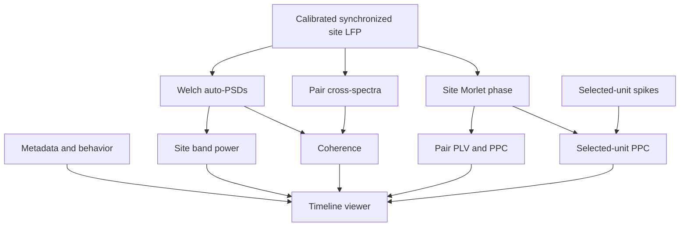

# Session Timeline Phase Synchrony and Band Power: Implementation Handoff

Status: Reviewed live draft, 2026-11-04, updated after implementation-chat feedback.
Native-rate Welch and cold-run primary-first publication are now explicit user
decisions. Phase preparation also requires drift-aware UTC waveform alignment
before Morlet and an explicit numerical amplitude threshold of 0.0.
Implementation approved by the user in the receiving chat on 2026-11-04.
Round 1 implementation and synthetic/designated-session validation may proceed
through the gates below; additional experimental sessions still require user
inspection. Historical documentation-only evidence is retained in Section 10.

Scientific authority: [spec](session_timeline_phase_synchrony_spec_v1.md).
Repository rules: [AGENTS.md](../AGENTS.md), [SoftwareDesign.md](SoftwareDesign.md).
This file owns delivery order, assignments, evidence, and the next action.
Maintain it during implementation, following the existing
[prediction handoff](condition_prediction_generalization_implementation_plan.md#0-live-implementation-handoff)
and [single-unit assignments](single_unit_plan.md#10-orchestrator-and-worker-assignments).

## 0. Live implementation handoff

Update the snapshot/ledger at RED, GREEN, review, and data-inspection boundaries
and before handoff. Append exact evidence to Section 10.

### 0.1 Current snapshot

| Field | Current value |
| --- | --- |
| Date / branch / inspected HEAD | 2026-11-04 / `refactor` / `ca6ee10f7332d3ad9b466942b0fa45ab1ae4481e`. Recheck; never reset to this observation. |
| Package / authority | WP1 RED authorized by user: "alright, then begin implementation". Full approved Round 1 scope retained. |
| Team / running work | Lead runtime model/effort not exposed; one scientific worker `gpt-6.1-sol` / `high`, agent `/root/scientific_worker`. WP1 RED only; no experimental jobs/browser server. |
| Feature files | Plan untracked; synchrony spec staged as an addition with unstaged refinements. No commits by this chat. Preserve the actual workspace files when handing off; HEAD alone omits them. |
| Other dirty work | Staged PCA spec, single-unit plan, and ridge spec; unstaged `src/main.py` and `src/neural_analysis/sync_ephys.py`; other untracked files. Preserve all of it. |
| Evidence | No feature RED/GREEN runs or measured runtimes in this chat. Metadata/source/doc checks in Section 10; no experimental arrays loaded here. Implementation-chat loader/validity checks are reported evidence, not this chat's analysis runs. |
| Next action | WP1 tests first, meaningful RED, lead-only test commit, then GREEN. CT026 spike validation selected by user: `ProbeB:8` with `HPC1`; no other units inferred. |

Approval of the full Round 1 sequence includes its synthetic and designated
single-session validation unless the user limits that approval. Record scope
once; do not add approval gates at every package. User inspection of CT026
output still precedes additional experimental sessions.

### 0.2 Package ledger

Assignments are planned. Advance a gate only after Sol inspects the actual
diff and evidence. Replace `not run` with commands/results/commits when obtained.

| Package | Planned owner | State / next gate | RED commit / command / result | GREEN / review evidence |
| --- | --- | --- | --- | --- |
| WP0 spec/handoff | Lead | Implementation approved | Not applicable | Section 10 doc checks |
| WP1 inputs/config/preparation contracts | Sol worker, high | GREEN reviewed; complete | `0726ee1`; fixture/acceptance follow-up `ef27189` | 44 feature tests passed; 44 metadata/loading regressions passed; source reviewed by lead |
| WP2 shared PSD/power/coherence | Sol worker, high | Not started; accept quadrature/segments/reuse | Not run | Not run |
| WP3 phase/LFP metrics/spike PPC | Sol worker, high | Not started; accept drift-corrected phases, thresholds, validity/sampling/estimands | Not run | Not run |
| WP4 persistence/discovery | Sol worker, high | Not started; accept identities/publication | Not run | Not run |
| WP5a execution/timing core | Sol worker, high | Not started; freeze stage contracts | Not run | Not run |
| WP5b thin CLI/batch | Optional Luna, medium, or lead | Not started; wrappers match frozen contracts | Not run | Not run |
| WP6a scientific figures | Sol worker, high | Not started; accept geometry/units/scales | Not run | Not run |
| WP6b route/widgets/Refresh | Optional Luna, medium, or lead | Not started; browser integration | Not run | Not run |
| WP7a synthetic/regression/browser audit | Sol lead; sequential Sol review if useful | Not started; synthetic gate | Not run | Not run |
| WP7b CT026 validation/timings | Sol lead | Not started; user inspects output | Not applicable unless correction needed | Not run |
| WP8 usage/final handoff | Lead; optional Luna for literal docs | Not started; Round 1 acceptance | Not applicable for docs only | Not run |

### 0.3 Resume procedure and first commands

1. Read this plan, spec, repository rules, and latest Section 10 entry. Check
   implementation authority and actual branch/HEAD/dirty state.
2. Inspect recorded agent IDs and running commands before replacing them.
   Preserve completed work and resume the unfinished gate. Stop for genuinely
   unexpected changes; do not reset the checkout or rediscover settled scope.
3. Record package, phase, model/effort, exact writable paths, and focused check
   before dispatch. Respect the single-worker and lead-commit rules in Section 9.
4. Before stopping, record commands/results/commits and any tool session/PID,
   log/output path, last durable product, and exact next action.

After approval, run a bounded existing baseline only if evidence is missing or
relevant edits invalidate it. Use `uv run --frozen --no-sync pytest` with actual
files covering affected metadata, LFP loading/power/phase/synchrony,
spike-phase/PPC, and timeline/chart behavior. The first WP1 action is writing
its tests and establishing meaningful RED, not invoking a nonexistent path.

## 1. Scope, inputs, and configuration

Round 1: a separate saved-result timeline with per-site integrated theta/gamma
power, pairwise magnitude-squared coherence and LFP PLV/PPC, and explicitly
selected-unit spike-LFP PPC. Primary `[-1,+1)` s; optional secondary `[-2,+2)` s,
shared across metrics. One estimate per choice; no across-trial pooling.
Before `[-2,0)` / after `[0,+2)` s is Round 2 after Round 1 and measured timings.
Moving windows, all-unit processing, significance, and cluster deployment
are outside Round 1.

Preserve the spec's Morlet 2-100 Hz / 2-Hz spacing on the 500-Hz phase grid,
theta 6-10 Hz, gamma 30-80 Hz excluding 58-62 Hz, enabled notch, complete-support
policy, and matched 0.5-s/50%-overlap periodic-Hann Welch settings. The spec owns
full definitions and interpretation; do not substitute convenient helper defaults.

Verified validation metadata (read-only inspection, not a readiness/analysis run):

`/home/matt/Documents/EXPERIMENTS/contextProjectData/CT026/CT026_20260828_latent_inference/neural_session.json`

- Session ID `CT026_2026-08-28_134630`; trial/event files have session-relative
  paths. Computational timestamps are UTC seconds.
- PFC1 = ProbeA saved channel 100; HPC1/HPC2 = ProbeB saved channels 222/14.
  Metadata pairs: HPC1-HPC2, PFC1-HPC1, PFC1-HPC2. These are validation facts,
  not hard-coded channel defaults for other sessions.
- Both LFP sidecars declare 2500 Hz and affine calibration to uV (gain about
  0.195, offset 0). Stored float32 values still require the existing loader's
  calibration. Prior phase-shift/bandpass/resampling is recorded; do not repeat
  it. Recheck metadata, paths, source identities, and synchronization at run time.

Use small immutable config/result records, not new metadata schema fields.
CLI defaults: primary interval; families `power coherence lfp-phase`; available
metadata sites/ordered pairs (spec fallback if pairs absent). `spike-ppc` requires
explicit probe-qualified unit IDs and LFP site. Quality selection follows the
existing interface. Missing inputs disable only dependent work. Validate each
requested component rather than requiring all probes, spike files, or pairs.

## 2. Architecture and verified reuse boundaries

Proposed new modules under `src/neural_analysis/phase_synchrony/`; ordinary
functions, with helpers local to the owning module. These are planned project
interfaces, not assumed library APIs.

| Module | Responsibility / planned functions | Package |
| --- | --- | --- |
| `results.py` | Config/result records, component identities, NPZ save/load/discovery | WP1/WP4 |
| `preparation.py` | Independent calibrated site/unit loading, shared UTC-grid waveform sampler, continuous preprocessing, `prepare_site_lfp` / `prepare_site_phase`, compatible preparation reuse | WP1/WP3/WP4 |
| `computation.py` | `compute_site_psd`, `compute_band_power`, `compute_welch_coherence`, `compute_lfp_phase_summary`, `compute_selected_unit_ppc`, strict band reductions | WP2/WP3 |
| `plotting.py` | Plotly timeline figures and Matplotlib validation PNG export from the same saved products; `export_validation_figures` | WP6a |
| `run_session.py` / `run_batch.py` | Execution/timing core first; thin CLI and session-list wrapper second | WP5a/WP5b |
| `webapp/phase_synchrony_view.py` | Separate route, selectors, saved discovery, Refresh, timing readout; localized existing app wiring | WP6b |



Reuse narrowly, after reading callers and verifying installed APIs:

- Behavior/clock: `prepare_timeline_choices` and `load_timeline_behavior` retain
  trial IDs/rows, UTC choice times, first-trial elapsed origin, and action codes.
  `add_timeline_behavior`, `render_timeline_navigation`, and
  `render_timeline_chart` can work with a behavior-only `SessionTimelineResult`
  (empty regions); no PCA fit is needed.
- Phase: `lfp/phase.py` continuous Morlet/notch/decimation is the reference.
  Verify the actual output rate: integer decimation need not yield exactly
  500 Hz for arbitrary sources. Reject incompatible caches/configurations
  rather than relabeling their samples. The production phase block loader in
  `lfp_summary/synchrony_runtime.py` anchors once and uses nominal-rate times;
  it cannot supply drift-aware phase unchanged. Use the shared UTC-grid sampler
  before decimation/Morlet, as specified in Section 3 and spec Section 4.2.
- `make_phase_trial_tensor` can interpolate across invalid source samples;
  `compute_site_phase_trial_tensor` can reject an entire padded block on a
  source/read error. Adapt narrowly so masks/gaps stay invalid and valid primary
  windows survive missing secondary support or an unrelated boundary trial.
  Record the real Morlet padding/support; do not create an edge-correction study.
- `compute_wavelet_coefficients` retains an unprocessed source trace. Do not
  reuse that trace as an already notched/decimated waveform. Avoid the full
  `lfp_summary` workflow: even warm `prepare_phase_run` reloads source traces;
  its payload adds unrequested across-trial analyses/bootstraps.
- `compute_trial_plv_by_frequency` defaults to 80% coverage and finite-only band
  averaging elsewhere; enforce complete window support and fixed retained
  frequencies. Publish PLV/PPC together from the same phase sums/counts.
- Spike sampling: `sample_wavelet_phase_at_spikes` expects coefficient results,
  not a cached unit-phase tensor. Reuse the existing complex interpolation/PPC
  core via a narrow public adapter if needed; never fabricate amplitudes to
  satisfy that API. Interpolate normalized complex phase vectors and normalize
  the result, matching that sampler; amplitude gates validity without weighting
  the phase interpolation. Match the exact-sample validity rule in `spike_lfp/ppc.py`
  / `ppc_kernel.py`: exact samples use their own validity; interpolation needs
  both valid neighbors, no extrapolation. Keep real right-neighbor support
  beyond the half-open metric window and record excluded spikes.
- Pin/save `numerical_amplitude_threshold=0.0`, matching `PhaseAnalysisConfig`.
  Pass `minimum_relative_magnitude=0.0` explicitly wherever a normalization or
  phase-sampling helper accepts it; never inherit its generic `1e-12` default.
  Absolute amplitude gating is disabled/0.0 by default. Positive finite
  coefficients below that generic relative cutoff remain eligible; zero,
  nonfinite, and undefined interpolants remain invalid. No new downstream cutoff.
- PSD/power: `lfp/power.py::compute_welch_psd` must have per-call notch disabled
  after continuous notch. Preserve actual Welch coordinates rather than
  silently interpolating them. `mean_band_power_linear` returns mean PSD
  density plus bandwidth: multiply them for total power, retaining its
  disjoint-interval/one-sided boundary quadrature.
- Coherence needs matched cross spectra as well as auto-PSDs. Share auto-PSDs
  only for identical samples, segment placements, preprocessing, units, and
  Welch settings. Do not invoke full Power baseline/dB/before-after workflows.
- Existing app readiness checks can require all probes/spikes/pairs. Keep the
  new route component-specific and able to load saved neural results without
  reopening raw binaries or requiring unrelated inputs.

Do not add a workflow engine, registry, job service, or broad refactor.

## 3. Data and inspection contracts

Every new function/record documents types, shapes/axes, units, and returns.
Keep UTC seconds internally and one first-trial elapsed origin for display.
Use explicit absolute-time tolerances (or relative coordinates), not default
relative `allclose` on billion-second UTC values.

Welch uses native-rate waveforms (2500 Hz for CT026), not the 500-Hz phase grid.
Follow spec Section 6.2.1: map each probe's source samples to choice-relative
time using its own synchronization. For `r = -a + arange(round(2*a*fs))/fs`,
evaluate each probe's IRIG UTC-to-native-index map at every `choice+r`, then
linearly sample continuously preprocessed real voltages at those fractional
indices. A nominal choice-anchored loader time vector alone is insufficient
when probe clocks drift. Bracketing loads/filter context
are support only; exact samples use their own validity, interpolation needs
two contiguous valid neighbors. Never pass extra loader samples into Welch.
One site's aligned row/segments must be identical for power and coherence.
Pair native-rate mismatch disables that coherence pair without implicit
resampling or disabling independent power.

Phase uses that same IRIG-to-native-index sampler on padded continuous blocks,
before decimation/Morlet (spec Section 4.2). Native calibration/notch -> uniform
UTC native-rate waveform -> existing anti-alias decimation/Morlet -> unit phase
-> trial/spike sampling on the corrected UTC time base. Disable the helper's
notch when already applied, while preserving actual notch provenance. Use
block-relative seconds plus saved UTC origin for precision, retaining real
padding/validity. Do not transform an irregular corrected time vector while
declaring it uniform, or relabel old nominal-block coefficients afterward.
Trial targets are `choice+r` on the 500-Hz phase grid; selected spikes retain
their already synchronized UTC timestamps, with no second LFP clock correction.
Matching phase-coordinate arrays alone do not establish recovered phase values.

| Product | Axes / required content |
| --- | --- |
| Site waveform | `(trial, time)`, calibrated voltage, actual coordinates/validity and preprocessing identity |
| Site phase | complex64 `(frequency, trial, time)` plus bool validity, actual grid and interpolation guard support; document any removed leading site axis |
| Site auto-PSD | `(trial, frequency)` in uV^2/Hz for calibrated uV; actual Welch grid/settings and per-trial sample/segment counts |
| Integrated power | `band_power_integrated` on `(trial, band)`, uV^2; `(band,)` retained bandwidths; source PSD reference, validity/reasons |
| Pair / unit-channel metrics | `(trial, frequency)` values/counts and `(trial, band)` summaries; distinguish phase and Welch frequency axes |

All products retain original trial IDs/row positions, exact interval bounds,
site/probe/channel/unit IDs, source/configuration identity, and exclusions.
Require 1,000/2,000 primary/secondary metric phase samples at 500 Hz, and
5000/10000 waveform samples for CT026 at 2500 Hz, yielding seven/fifteen Welch
segments. Invalid secondary support must not discard valid primary data.
LFP support is complete; spike PPC retains valid spikes with per-frequency
counts/exclusions. Band spike-count labels show the min-max over retained
frequencies (or explicitly common N), with exact per-frequency counts available;
never pool frequency counts. No new 50-spike cutoff. Keep negative PPC.

Power integrates frequency, not time: constant PSD density q gives theta
`4*q` and retained gamma `46*q`. Genuine zero power is valid even if phase or
coherence is undefined. Missing retained support is unavailable, not zero.

Persist enough for the spec's selected-choice inspection: prepared calibrated
waveforms, identified frequency/phase data and validity (or durable references
to compatible preparation), selected spike timestamps, and fixed-bin per-trial/
frequency polar histogram counts/edges derived with the same sampling rule.
The viewer must not reopen raw LFP/spike sources or rerun transforms/PPC to
draw inspection plots. Avoid saving dense spike-by-frequency arrays when
histograms plus timestamps suffice.

## 4. Storage, reuse, and execution

Reusable preparation belongs under the original session's
`processed/session_timeline_phase_synchrony/`; retain existing compatible mmap
phase storage where suitable. Each invocation creates a new session-local run:

```text
analysis_runs/session_timeline_phase_synchrony_<date>_<time>_<run_id>/
  config.json, run.log, summary.md, measurements.json
  run_session.py, run_batch.py
  components/<family>/<selection>_<interval>.npz
```

Save script copies and named arrays with dictionary-valued `meta`: generator,
analysis/schema versions, effective parameters, source/preparation IDs, seed
if applicable, units/axes, timings, UTC completion time, and run ID.
Experimental files stay outside Git.

One immutable, atomically renamed NPZ is one completed component for all trials
of one site/pair/unit-channel and interval. Temporary/invalid/incompatible
files are ignored. No separate per-NPZ completion receipt is needed; existing
multi-file preparation caches retain their completion-marker contract.
Persist measurements after each completed/failed stage. Explicit reruns create
new runs and never overwrite historical results.

Allow **one preparation writer per session** plus read-only viewers; reject
or clearly report another active writer using a simple existing lock pattern.
Separate component commands run sequentially, including after an interruption;
no concurrent-writer cache coordination is required. Recover a stale lock only
after checking its recorded process. Across-session batch processes are separate.

Discovery can combine completed products across runs when relevant identities
match. For duplicate component identities, select the maximum tuple of parsed
UTC completion time, run ID, and relative product path (lexicographic string
ties). Show the selected run/time in details. Newer failed/unfinished
attempts do not displace an older compatible completed product; report both
the displayed source and newer attempt status. Ignore filesystem mtime/order.
A new unit/display selection must not invalidate site power/coherence.
PSD identity includes exact samples/segments, preprocessing, units, and Welch
settings plus waveform alignment/synchronization semantics; band-integration
changes alone do not invalidate it. Phase reuse requires matching coordinates,
support/guards, validity, transform settings, and the scientific marker
`phase_support_semantics="strict_support_v1"`, plus
`phase_alignment_semantics="irig_uniform_utc_pre_morlet_v1"`, actual IRIG/offset
identity, block UTC origin/bounds, grid rates, operation order, and effective
numerical/absolute thresholds. Reject legacy phase preparations and derived
products with missing/wrong alignment semantics or incompatible thresholds,
even if marked `strict_support_v1` with all-valid masks. Recompute; do not
relabel legacy data.
Independent power/coherence remain reusable. No viewport cache keys or general
provenance/DAG system.

The runner exposes metric families, sites/pairs/units, primary/secondary
intervals, preparation-only LFP/phase actions, explicit order, dry-run, reuse,
and additive rerun. Dry-run reads metadata/sidecars and lists missing/reusable
work without loading numerical data or creating outputs. Example proposed CLI
(not available yet; defaults in Section 1):

```bash
uv run -m src.neural_analysis.phase_synchrony.run_session \
  --session-metadata /path/to/neural_session.json \
  --components power --sites SITE --intervals primary secondary

uv run -m src.neural_analysis.phase_synchrony.run_session \
  --session-metadata /path/to/neural_session.json \
  --components spike-ppc --unit PROBE:CLUSTER --lfp-site SITE --intervals primary
```

Component-only work runs only missing prerequisites. Power needs one site, no
pairs/phase/spikes/cross spectra; coherence needs no power integrals/phase/spikes;
spike PPC needs no pairwise metrics. Publish each primary product immediately,
before secondary/other selections finish. When both intervals are requested,
run a primary sweep before secondary-only work. Within each sweep, provisionally
run power, coherence, LFP phase, then spike PPC (or explicit family order);
use measurements to recommend the eventual order.
Primary-first latency takes precedence over avoiding repeated phase work.
Reuse existing wider support or support obtained by the same required transform;
otherwise prepare/publish primary first and allow additional secondary
preparation. Record extra transforms/support/time and actual reuse. Do not
recompute or replace a completed compatible primary product solely to prepare
secondary results. This is not a promise of one transform for both cold-run
intervals, nor a requirement for a new partial-transform checkpoint system.

On failure, save the error, skip dependents, and continue independent work;
return nonzero when requested work failed. Invalid trial support is a data
status, distinct from execution failure. Completed results remain usable.

## 5. Viewer and outputs

Reuse behavior/navigation with a separate route and light mode. Load behavior
tables plus compatible saved neural products; a standalone archive viewer
without behavior files is not required. Missing/failed/unfinished components
are labeled. Manual Refresh rediscovers completed products without numerical
preparation or losing the panned range; do not cache absence indefinitely.
No app background jobs, polling service, or automatic scheduling.

Show choice-time markers and optional frequency-by-choice heatmaps with true
interval bounds and blank inter-trial gaps; no lines or stretched cells bridge
choices. Include PLV/PPC toggle, separate coherence and power labels, selected
unit counts, and selected-choice LFP/phase/spike/polar inspection. Preserve
actual time, source identities, interval, frequency, support, and units in
hover/details. Follow the spec's captions and scientific interpretation notes.

Stable scales while panning: PLV/coherence 0-1; signed PPC retaining negatives;
separate nonnegative physical-unit power axes per site/band/configuration.
Reuse native chart persistence and explicit viewport controls; no new pan
callbacks. Keep saved values invariant under navigation/display changes.
Keep Plotly for the interactive viewer. WP6a implements
`export_validation_figures` with existing Matplotlib/Agg; WP7b calls it on saved
products to write captioned, opaque-white PNGs under the run's `figures/`
directory (timeline overview and selected-choice/frequency inspection).
This export does not require Kaleido or browser downloads. Verify the saved
images visually; time export separately from numerical preparation.

## 6. Timings and measured processing order

Use exclusive monotonic wall timers. Charge shared prerequisites once and
report reused work explicitly. Required useful boundaries:

| Stage | Timing separation |
| --- | --- |
| Input setup | Metadata/behavior/sidecar validation vs numerical data loading |
| LFP preparation | Per-site I/O/synchronization vs continuous preprocessing/UTC-grid sampling, including padded phase blocks; cache validation/load vs cold work |
| Morlet preparation | Transform/extraction vs LFP phase reductions; record support/frequencies, reused support, and any extra secondary preparation |
| Welch auto-PSDs | Per site/interval preparation and cache I/O, shared once by power/coherence |
| Band power | Incremental theta/gamma integration and output writing/loading |
| Coherence | Matched cross spectra and ratio, excluding already charged auto-PSDs |
| Spike PPC | Selected-unit loading vs selection/phase sampling/PPC; counts/exclusions |
| Publication/display | Product write/load, figure construction/serialization, payload bytes, Matplotlib PNG export |

Where a verified API bundles operations, report the combined stage honestly;
do not refactor the numerical API solely to split microtimers. Use `cProfile`
on a dominant stage before proposing optimization. No pairwise PPC matrices,
dense empty session grid, or premature within-session multiprocessing.

After synthetic acceptance, measure CT026 with both centered intervals, all
requested metadata sites/pairs, one explicit unit and a small explicit multi-unit
selection. Do not benchmark all units or invent durations. Include power-only
cost, incremental power from cached PSDs, and reuse by later coherence.
Record configuration, trial/site/pair/unit/sample/frequency/segment counts,
hardware, cache state, status, elapsed time, file size, and major array sizes.
Cold analysis cache does not mean cold OS cache; process peak RSS is a lifetime
high-water mark, not a per-stage peak.

Report time to first durable neural product, subsequent publication delays,
and warm load/Refresh cost in `measurements.json`, `summary.md`, and a compact
viewer table. Inspect initial display/navigation in the browser; label
responsiveness qualitative unless actually measured end to end. Do not
mislabel Python figure-build time as browser latency or repeat costly cold
runs merely to fill a table. Recommend the work order/local offline approach
from evidence; defer major optimizations/cluster decisions to measured need.

## 7. Tests first and acceptance

Use pytest functions, seeded fixtures, and `uv run`. For each increment:
write tests -> demonstrate meaningful RED -> commit tests -> GREEN -> refactor.
Only intended paths enter commits; preserve unrelated staged user work.
Planned tests under `src/tests/neural_analysis/phase_synchrony/`:

| Files / package | Oracles and failure cases |
| --- | --- |
| `test_configuration.py`, `test_preparation.py` / WP1 | Original trial IDs/origin, half-open samples/spikes, UTC tolerance, metadata channels, calibrated units; off-grid choices and differently offset/drifting probe clocks produce the same native-rate target coordinates; bracketing load vs exact metric rows; missing/gapped support and pair-rate mismatch; existing preprocessing equivalence/no double notch |
| `test_power_coherence.py` / WP2 | Voltage x2 gives power x4; constant PSD integrates to 4q/46q; helper-times-bandwidth equivalence; excluded-gap values cannot contaminate boundaries; missing retained support vs valid zero; actual grids; seven/fifteen matched segments; SciPy coherence equivalence; one-segment/zero-denominator rejection; no trial pooling |
| `test_phase_metrics.py`, `test_spike_ppc.py` / WP3 | Drift fixture recovers phase differences, LFP PLV/PPC, off-grid UTC spike phases/PPC against independent analytic/no-drift references, far enough from block start to fail nominal-only timing; explicit 0.0 threshold retains tiny positive coefficients below the generic 1e-12 relative cutoff, rejects zero/nonfinite; other phase/count/interval oracles below |
| `test_results.py`, `test_stage_independence.py` / WP4 | Named-array/meta round trip incl. inspection inputs; otherwise matching legacy phase cache/derived results rejected despite saved all-valid mask; wrong source/settings/support rejected; temp/corrupt files ignored; immutable reruns/writer conflict; duplicate-run completion-time order/ties, older-result fallback on newer failure/unfinished work, mtime ignored; independent identities and shared PSD reuse |
| `test_runner.py` / WP5a | Only requested prerequisites; primary sweep/early publication with permitted/timed additional secondary preparation; unchanged primary product preserved; explicit order; failure isolation; shared costs charged once; reused/failed timing states; dry-run loads no signals/writes nothing |
| `test_scripts.py` / WP5b | CLI validation, explicit units, preparation-only/rerun/reuse/dry-run; batch delegates unchanged config and session-worker limit |
| `test_plotting.py` / WP6a | Real time/gaps/intervals/heatmap geometry; values/support/units/light mode; fixed scales; frequency-dependent band count ranges; saved selected-choice inspection; captioned Matplotlib PNG export into run/figures without Kaleido |
| `test_webapp.py` / WP6b | Component-specific route; behavior-only/power-only/partial states; Refresh discovers new products without recomputation; viewport persists; selected source run/time and newer failed-attempt status remain distinct |
| `test_synthetic_integration.py` / WP7a | Seeded LFP/spikes, both intervals/all families, separate invocations, failure/restart/reuse, power visible before later work, saved/direct agreement |

Use controlled stage holds for publication tests, not elapsed-speed assertions.
WP3 also retains known nonzero-offset/PLV-PPC identity, negative PPC, counts <2,
1,000/2,000 metric samples excluding guards, gap masks, valid-primary/invalid-
secondary independence, fixed frequency sets, two-spike cosine identity,
normalized-vector interpolation with unequal amplitudes, exact/neighbor/wrap
and boundary-count checks, and no unit pooling/50-spike threshold. Drift tests
must check numerical phases and PPC, not only identical target coordinates.
WP4 adds rejection of otherwise matching strict-support caches lacking the new
alignment method, threshold-change invalidation, and explicit 0.0 round trips.
Duration-scaling power tests use deterministic identical-segment PSDs, not a
requirement that two noise estimates match numerically. Independent finite
signals need not have exactly zero coherence. Add relevant existing metadata,
LFP, spike-phase/PPC, chart/timeline, and routing regressions when touched.
Browser inspection covers hover, navigation, added tracks, Refresh, and
responsiveness; Python tests alone do not establish browser behavior.

## 8. Delivery, dependencies, and data gate

Sequential delivery:
`WP1 -> WP2 -> WP3 -> WP4 -> WP5a -> WP5b -> WP6a -> WP6b -> WP7a -> WP7b -> WP8`.

Scientific contracts precede persistence/execution, then frozen figure/result
interfaces precede thin UI/CLI work. Each package uses Section 9's RED/GREEN/
review gate. WP7a completes synthetic/regression/browser acceptance; WP7b runs
and benchmarks CT026 under recorded authority. Present scientific figures,
timings, first-result latency, and a measured work-order recommendation. User
inspection precedes other experimental sessions; Round 2 awaits Round 1 and
its timing assessment. WP8 updates usage in `SESSION_TIMELINE.md`/neural README,
captions, limitations, live ledger, and final handoff.

Before spike-PPC validation, record the explicit CT026 probe-qualified unit IDs
and LFP sites selected through the existing interface. LFP validation proceeds
independently; do not choose arbitrary units or treat this outstanding selection
as a reason to stop power/coherence/phase implementation.

No new dependencies: existing NumPy, SciPy, pandas, Pynapple, Plotly, Matplotlib,
Streamlit, pytest, and standard library. Verify APIs against installed source/official
docs; do not modify dependencies. Batch wrapper parallelizes across sessions,
defaults to available CPU cores capped by session count, and permits a lower
worker limit for RAM/I/O. Building it does not authorize an experimental batch.

## 9. Agent assignments and gates

### 9.1 Roles and concurrency

**One Sol orchestrator; at most one active worker** (two active agents total).
Use zero workers for small lead-owned tasks. Reuse contexts sequentially; no
subworkers, speculative per-file agents, simultaneous Sol/Luna workers, or
standing reviewer team.

| Role | Model / effort | Scope |
| --- | --- | --- |
| Lead | `gpt-6.1-sol` / `high` | Scope, architecture, worker-diff review, integration, Git commits, live records, user communication, WP7 validation/timing interpretation |
| Scientific worker | `gpt-6.1-sol` / `high` | WP1-WP4, WP5a execution/timing, WP6a scientific plots, bounded scientific corrections/review |
| Optional routine worker | `gpt-6-luna` / `medium` | WP5b wrappers, WP6b mechanical widgets/routing, WP8 literal usage after Sol freezes contracts; `low` for literal docs only |

Calibration, synchronized time, estimators, axes/units, support, integration,
cache identity, shared-cost accounting, and plotted-data alignment stay with
Sol. Return Luna work to Sol if it touches those decisions. Report unavailable
model IDs rather than silently substituting; record actual model/effort/agent
ID. These assignments do not change this chat's runtime model and do not
promise a measured cost/speed advantage. They follow task-based
[model selection](https://developers.openai.com/api/docs/guides/model-selection)
and [reasoning effort](https://developers.openai.com/api/docs/guides/deployment-checklist).
Agent limits do not change CPU-process policy across sessions.

### 9.2 Dispatch, file ownership, and TDD gates

The module and test tables define ownership. Each dispatch names package/phase,
baseline HEAD/relevant dirty state, exact writable files, frozen data contracts,
spec sections, oracle/acceptance conditions, and focused check. Existing helper
changes must be explicitly scoped after reading callers. Sol releases
`run_session.py` before Luna edits its CLI; localized `webapp/app.py` /
`session_inputs.py` wiring belongs to WP6b. No concurrent edits to owned files.

1. Worker writes assigned tests only, reports meaningful RED and oracle, and
   stops. Missing dependencies/broken setup do not count as feature RED.
2. Lead reviews/reproduces RED and commits only intended tests, preserving
   unrelated staging. Record the test commit before releasing GREEN.
3. Worker implements, runs focused checks/regressions, reports exact results
   and unresolved issues, and becomes idle before lead integration.
4. Lead inspects diff/evidence, runs bounded acceptance, and alone commits
   accepted implementation/handoff. Record commits and next gate before
   dependent work. Do not weaken tests to get GREEN; document genuine fixture
   corrections or changed requirements.
5. Resume interruptions from actual files/evidence. Return scientific issues
   to Sol. No reset/rewrite of completed work merely to recover context.

Workers do not stage/commit, amend/reset, change dependencies, launch
experimental jobs, or spawn agents. No extra worktree is needed solely for
this sequential arrangement. When the lead writes substantive science, use
the idle Sol worker for bounded read-only review if useful; otherwise label
self-review honestly. No permanent additional reviewer is required.

## 10. Execution and evidence log

Append dated entries at decisions, test/implementation commits, reviews,
interruptions, worker/model changes, and data validation. Keep earlier evidence;
correct a mistaken historical statement with an appended correction. Use:

```text
Date/time/timezone - package / phase:
Authorization and actual lead/worker model, effort, agent ID:
Baseline/end HEAD; relevant dirty state; exact writable/changed files:
RED command, expected/actual result, test commit:
GREEN/regression/review commands, counts, warnings, implementation/review commits:
Scientific/interface changes or unresolved findings:
Running tool session/PID/command/log path, or none:
Saved synthetic/experimental products; measured resources/timings, or not measured:
Exact next action, owner, and remaining authority or user-inspection gate:
```

### 2026-11-04 - WP0 / live handoff and agent-assignment revision

- Authority: user requested a live implementation handoff matching other plans,
  with a Sol orchestrator, Sol/Luna workers by scientific complexity, and a
  minimal active team. Earlier accepted scope includes both centered intervals,
  per-site integrated power, separate processing/timings, CT026 2026-08-28, and
  light mode. This remains documentation-only authority.
- Inspected the live snapshot/ledger/resume patterns in the prediction and
  pooled-decoding plans and the Sol/Luna single-writer gates in the single-unit
  and prediction plans. Preserved the existing architecture/scientific scope.
- Baseline: branch `refactor`, HEAD
  `ca6ee10f7332d3ad9b466942b0fa45ab1ae4481e`. The feature plan is untracked;
  synchrony spec has staged and unstaged content. Other staged/source changes
  are listed in Section 0.1 and were not edited, staged, or committed here.
- Added the live snapshot, package ledger, resume procedure, model/file
  assignments, one-active-worker cap, and sequential RED/lead-commit/GREEN/
  review contract. Section 6's computation timing and early-publication
  requirements remain unchanged.
- Workers, source/test edits, RED/GREEN runs, Git commits, experimental runs,
  cluster work, and measured feature runtimes: none.
- Documentation verification: read-only Python assertions passed using
  `UV_CACHE_DIR=.pytest_cache/uv uv run --frozen --no-sync python -c` for ASCII,
  trailing whitespace, balanced code fences, local document links/anchors,
  snapshot/ledger/resume sections, all WP entries, model assignments, and
  retained scientific/timing clauses. No pytest or feature computation ran.
  `git diff --check -- docs/session_timeline_phase_synchrony_spec_v1.md` passed;
  the new plan's whitespace scan reported no diagnostics. Rechecked
  `git diff --cached --name-status`, `git diff --name-status`, and
  `git rev-parse HEAD`: existing staged/source paths and HEAD are unchanged.
- Next action: user review; after implementation approval, Sol starts WP1 RED
  using the checkout/authority procedure above. No worker should be started
  merely because assignments have been documented.

### 2026-11-04 - WP0 / correctness, completeness, and scope review

- Authority: user requested review for implementation by another lead.
  Documentation only; no workers, source/tests, analysis runs, or commits.
- Condensed Sections 0-9, removing repeated scope/assignment prose. Current
  sections supersede earlier draft mechanics; historical evidence is unchanged.
  Accepted estimands, intervals, TDD, timings, and one-worker cap are retained.
- Simplified to one preparation writer per session and atomic completed NPZs;
  removed per-component receipts and concurrent-writer cache coordination.
  Bundled APIs may report combined preparation timings instead of requiring
  numerical refactors solely for microtimers; browser latency claims need
  browser measurements.
- Source audit clarified invalid-gap interpolation, block-wide phase exclusion,
  coefficient versus unit-phase sampling, exact-sample/neighbor validity,
  calibration, component-specific route readiness, and saved inspection inputs.
  Added the verified CT026 metadata path/rates/calibration from read-only
  metadata/sidecars; no binary LFP or spike arrays were loaded.
- Read-only documentation assertions passed via
  `UV_CACHE_DIR=.pytest_cache/uv uv run --frozen --no-sync python -c`:
  ASCII/whitespace/fences, local links/anchors, ledger/model/scientific/timing
  contracts, session metadata path, and unchanged historical log. No pytest or
  feature numerical validation is claimed. Final whitespace checks had no
  diagnostics; staged/unstaged paths and HEAD match Section 0.1. The scientific
  spec is byte-for-byte unchanged by this review. Plan length fell from
  6,216 to about 4,400 words, including the preserved historical log.
- Next: user approves implementation scope; receiving Sol starts WP1 RED.
  Choose explicit benchmark units before spike-PPC validation, independently
  of LFP work. No further scientific spec decision was identified.

### 2026-11-04 - WP0 / implementation-chat feedback and resolved choices

- Corrects the prior readiness assessment: waveform grid/alignment and the
  cold-run latency/reuse precedence were insufficiently explicit. User chose
  native-rate Welch and primary-first publication with separately timed extra
  secondary preparation permitted. Updated spec and plan together.
- Native waveform rows use per-probe synchronization and a shared choice-relative
  grid; loader brackets are support, not extra observations. Added off-grid,
  cross-probe, and rate-mismatch checks. Phase remains on the 500-Hz grid.
- Strict scientific phase-support versioning now rejects legacy/derived phase
  products that cannot establish valid-gap/guard semantics. Added deterministic
  duplicate-run selection/fallback, source-run details, band spike-count ranges,
  session-relative *path* wording, and Matplotlib validation PNG export.
- Verified the loader's floor/ceil mapping, existing phase helper behavior,
  Matplotlib dependency, and project plotting/export precedent from source.
  Implementation-chat numerical checks are reported evidence; this chat did
  not reproduce experimental reads or run feature analysis/tests.
- Read-only documentation assertions passed via
  `UV_CACHE_DIR=.pytest_cache/uv uv run --frozen --no-sync python -c` for both
  files' whitespace/fences/links, plan ASCII, preserved history, resolved
  decisions, assignments/TDD contracts, and native-rate sample/segment constants.
  No workers, source edits, dependency changes, staging/commits, or experimental
  outputs. Existing HEAD/dirty work and prior evidence are preserved.
- Next: receiving Sol verifies actual implementation authority and starts or
  resumes the appropriate TDD gate. Explicit benchmark unit/site selection
  remains required only before spike-PPC validation; LFP work is independent.

### 2026-11-04 - WP0 / phase drift and amplitude-default clarification

- Authority: user supplied the remaining phase-alignment/default findings.
  Verified the production loader's block-start/nominal-rate construction,
  `PhaseAnalysisConfig.numerical_amplitude_threshold=0.0`, and generic phase
  normalization's `minimum_relative_magnitude=1e-12` default in source.
- Spec Section 4.2 and this plan now place full per-probe IRIG waveform sampling
  before anti-alias decimation/Morlet, sharing the UTC-grid sampler with Welch.
  Corrected phase retains UTC origin/guards; already synchronized spike times
  are sampled directly without a second LFP clock correction.
- Added `phase_alignment_semantics="irig_uniform_utc_pre_morlet_v1"`, actual
  synchronization/block/grid identity and explicit numerical/absolute thresholds
  to phase/derived-result compatibility. Strict support masks alone are not
  sufficient. Pin numerical threshold 0.0 instead of generic helper defaults.
- Extended WP3 oracles to recovered circular phase differences and spike
  phases/PPC under drift, using independent analytic/no-drift references and
  choices far from block start. Added tiny-positive/zero/nonfinite threshold
  checks and WP4 alignment/threshold cache rejection and metadata round trips.
- Read-only documentation assertions passed via
  `UV_CACHE_DIR=.pytest_cache/uv uv run --frozen --no-sync python -c` for both
  files' whitespace/fences/links, plan ASCII, unchanged historical evidence,
  explicit drift/threshold/cache/test requirements, and retained TDD/agent gates.
- Documentation-only revision: no source/tests, workers, experimental reads,
  analysis runs, dependency changes, staging, or commits. Prior evidence and
  unrelated working-tree changes are preserved. Next: receiving lead verifies
  authority and implements through the recorded TDD gates; benchmark unit/site
  selection remains a spike-validation prerequisite.

### 2026-11-04 20:27 America/New_York - WP1 / authorized RED dispatch

- Authority: user approved implementation: "alright, then begin implementation".
  Approved Round 1 sequence includes synthetic and CT026 validation; explicit
  spike unit/site selection requested asynchronously and remains pending.
- Baseline HEAD: `ca6ee10f7332d3ad9b466942b0fa45ab1ae4481e`, branch `refactor`.
  Existing staged specs/plans, unstaged main.py/sync_ephys.py, and untracked
  user files preserved. Lead owns this handoff and all Git operations.
- Lead runtime model/effort not exposed. One worker: `gpt-6.1-sol` / `high`,
  agent `/root/scientific_worker`; no additional worker or experimental job.
  Exact WP1 RED writable paths: new `test_configuration.py` and
  `test_preparation.py` under `src/tests/neural_analysis/phase_synchrony/`.
  No implementation changes released before lead review and test commit.
- Baseline command: `UV_CACHE_DIR=.pytest_cache/uv MPLCONFIGDIR=.pytest_cache/matplotlib
  uv run --frozen --no-sync pytest -q` with existing test_lfp_loading.py,
  test_lfp_power_summary.py, test_lfp_phase_clustering.py,
  test_lfp_synchrony_summary.py, test_session_timeline_webapp.py, and
  test_timeline_chart.py. Result: 77 passed, 1 skipped in 4.50 s; Node missing
  for the existing frontend lifecycle test. No feature validation claimed.
- Read CT026 metadata/sidecar only, not signal arrays. Next: worker reports
  substantive WP1 RED; lead inspects/reproduces and commits exact tests.

### 2026-11-04 20:32 America/New_York - WP1 / validation selection and baseline

- User selected "use hpc1 and probeB:8": canonical metadata IDs `HPC1` and
  `ProbeB:8`. This is the explicit designated spike validation selection;
  no additional units or experimental sessions are authorized by inference.
- Located bundled Node without adding a dependency. Re-ran the previously
  skipped renderer test with `NODE_BINARY=/home/matt/.cache/codex-runtimes/codex-primary-runtime/dependencies/node/bin/node`
  and the same uv/cache environment: test_timeline_chart.py, 2 passed in 0.24 s.
- Read only the CT026 sync NPZ `meta` entry: nominal AP sample_rate_hz=30000.0
  is recorded. Preserve IRIG drift when converting AP indices to derived LFP
  indices; do not replace this known conversion rate with an anchor-slope rate.
  No raw LFP/spike arrays loaded, scientific feature timings not yet measured.

### 2026-11-04 20:35 America/New_York - WP1 / RED reviewed and committed

- Lead reviewed all 514 test lines and numerical/fixture contracts. Corrected
  genuine fixture errors before commit: existing behavior flag is
  `experimenter_reward_given`; quality CSV requires channel_id/x_um/y_um.
- Reproduced worker RED command from 20:27 entry with the two new tests:
  2 collection errors in 1.11 s, exclusively missing proposed feature package
  `src.neural_analysis.phase_synchrony`; installed dependencies are available.
  These are committed substantive feature tests, not a passing test claim.
- Test commit `0726ee1` contains only test_configuration.py and
  test_preparation.py. Existing four staged user documentation files preserved.
- Released GREEN to the same Sol/high worker with exact new writable files:
  phase_synchrony/__init__.py, results.py, preparation.py. Tests frozen except
  documented genuine errors. No experimental work or next-package writes.
- Next: inspect WP1 implementation and focused/regression evidence before
  committing GREEN and releasing WP2 RED.

### 2026-11-04 20:39 America/New_York - WP1 / GREEN reviewed

- Worker implemented only phase_synchrony/__init__.py, results.py and
  preparation.py. Lead read all source and test contracts. Existing public
  modules/dependencies unchanged; direct scalar/data records and functions.
- Initial GREEN found a genuine fixture filename error: existing quality
  loader accepts channel_quality.csv/json, not quality.csv. Corrected it in
  test commit `ef27189`; added a passing review check of UTC-representable
  exact native hits versus distinguishable fractional offsets. No separate
  RED is claimed for that extra acceptance check (implementation already
  satisfied the existing exact-hit/precision contract).
- Lead focused command: same WP1 pytest files/cache environment; 44 passed
  in 1.44 s. Existing test_session_metadata.py and test_lfp_loading.py:
  44 passed in 0.77 s. Worker independently obtained 44/44 passing results.
- UTC sampler preserves per-probe drift, calibrated uV, local gap validity,
  and exact half-open grids; notch is continuous and reused without doubling.
  Explicit selected-unit loader retains existing good/mua/channel rules.
- No signal data/experimental analyses or feature performance measurements.
  Lead commits accepted source and this handoff only; user staging preserved.
  Next gate: WP2 shared PSD/integrated power/coherence tests first.
