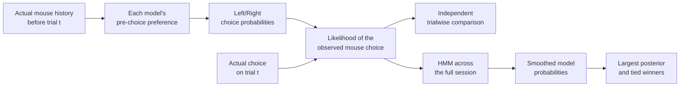

# How the trial-policy HMM works

This document explains the modeling logic used to compare behavioral policies
and infer which policy best explains each part of a session. It describes the
nine default candidates as of November 18, 2026. It is a conceptual companion to
the [trial-policy HMM specification](trial_dynamax_hmm_spec.md), rather than an
implementation specification.

## 1. The question being asked

The analysis asks:

> Given the mouse's observed choices and reward history, which candidate policy
> best explains its choices at each point in the session?

It answers this in two stages:

1. Each candidate assigns a probability to the mouse's actual choice on each
   eligible trial, using only the history available before that choice.
2. An HMM combines those likelihoods across the session, with a prior preference
   for continuing to use the same policy rather than switching policies rapidly.

The reported **most likely active model** is the model with the largest smoothed
posterior probability at that trial. This is retrospective support among the
available candidates. It does not establish that the mouse actually implements
that model's internal mechanism.

## 2. Two different HMMs

The name HMM appears in two places with different meanings.

The **Bayesian task-belief candidate** tracks two possible task contexts:
Left-active and Right-active. It uses outcomes to infer which side is currently
active, then converts that belief into a choice preference.

The **outer policy HMM** tracks which behavioral candidate best explains the
mouse's choices. Its nine states are the nine candidate policies, including the
Bayesian task-belief candidate.

These are separate calculations. The outer HMM is not a joint model with nine
policies multiplied by two task contexts.

## 3. All candidates see the same actual history

Every candidate is evaluated against the mouse's actual preceding behavior.
For each trial, the conceptual order is:

1. Predict Left/Right probabilities from the preceding usable history.
2. Evaluate the probability assigned to the mouse's observed choice.
3. Use the current choice and outcome to update the candidate for later trials.

No model choices are sampled. A candidate does not receive a simulated sequence
of its own preferred actions. Every candidate continues to update throughout
the session, including stretches where another candidate has the highest HMM
support.

Reward means binary reward delivery or omission, not reward volume. Rewards
affect the candidates' histories, but the outer HMM scores **choice likelihoods
only**: it does not multiply in a separate likelihood for the observed reward.

The candidates' internal values, beliefs, and counters change with history.
Their learning rates, temperatures, and other parameters are fixed for this
comparison; they are not fitted to the session.

## 4. The nine default candidates

A positive signed score favors Left; a negative score favors Right. The score
does not itself have to be a probability or use the same scale across models.

| Candidate | Source of its preference | Choice rule |
|---|---|---|
| Forgetting Q-learning (FQL) | Difference between decaying action values | Logistic, temperature 0.14 |
| Bayesian HMM | Belief about which task context is active | Logistic, temperature 0.40 |
| Win-stay/lose-switch (WSLS) | Last usable choice and outcome | 90% follow the rule, 10% opposite |
| Standard Q-learning (QL) | Difference between learned action values | Logistic, temperature 0.14 |
| Ideal observer | Reward-decay belief adjusted by omission doubt | Logistic, temperature 0.40 |
| Weighted perseveration | Exponentially weighted previous choices | Logistic, temperature approximately 0.455 |
| Win-switch/lose-stay | Last usable choice and outcome | 90% follow the rule, 10% opposite |
| Home expectancy + doubt (Home E+D) | Reward-confirmed home, reward expectancy, and omission doubt | Logistic, temperature 0.50 |
| Chance | No directional preference | Constant 50/50 |

These are the default candidates, not a requirement that every comparison use
all nine. Subsets remain possible. Immediate persistence, the standalone
reward-decay HMM, and probe-persistence-doubt also remain available as optional
candidates.

### 4.1 Standard Q-learning

QL stores one value for each action, initially zero. Before trial \(t\), its
score is

\[
s_t = Q_{L,t} - Q_{R,t}.
\]

After a usable choice and outcome, only the chosen action's value changes:

\[
Q_{a_t,t+1} = Q_{a_t,t} + \alpha(r_t - Q_{a_t,t}),
\qquad \alpha = 0.3.
\]

The unchosen action's value stays unchanged. A reward raises the chosen value
toward one; an omission lowers it toward zero. The preference is converted to
choice probabilities using temperature 0.14.

### 4.2 Forgetting Q-learning

FQL also starts with zero values and uses \(Q_L-Q_R\) as its pre-choice score.
After a usable outcome, both values first decay:

\[
Q_L \leftarrow dQ_L, \qquad Q_R \leftarrow dQ_R,
\qquad d = 0.7.
\]

Then the chosen action receives a reward contribution:

\[
Q_{a_t} \leftarrow Q_{a_t} + (1-d)r_t.
\]

An omission therefore decays both values without adding reward. This differs
from standard QL, where the unchosen value is retained. FQL also uses temperature
0.14.

### 4.3 Bayesian task-belief model

This candidate starts with equal belief in Left-active and Right-active
contexts. Its default task assumptions are:

- Reward probability on the active side: 0.8.
- Reward probability on the inactive side: 0.
- Probability of a context transition between usable updates: 0.2.

After a choice and observed outcome, it updates its context belief using Bayes'
rule, then applies the context-transition probability to form the next trial's
prior belief. Both rewards and omissions provide evidence. An omission on a
side is less compatible with that side being active, although an active side
can still omit reward.

Its pre-choice score is a bounded transformation of context log odds:

\[
s_t = \tanh\left(
\log\frac{P(\text{Left active before trial }t)}
{P(\text{Right active before trial }t)}
\right).
\]

The default scale inside this transformation is one. A separate logistic rule
with temperature 0.40 converts the score to choice probabilities.

Consequently, the probability that Left is active and the probability of choosing
Left are different quantities. The model does not simply use its context belief
as its behavioral choice probability.

### 4.4 Ideal observer

The candidate called the ideal observer is a particular combination of
reward-decay belief and omission doubt. It is not an oracle that knows the true
task context.

Its belief component uses a Bayesian update after rewards. After omissions,
instead of treating the omission as ordinary Bayesian evidence, it shrinks its
context log odds toward zero:

\[
B_{\mathrm{post}} = (1-\lambda_{\mathrm{decay}})B_{\mathrm{prior}},
\qquad \lambda_{\mathrm{decay}} = 0.1.
\]

It then applies the same default context-transition probability of 0.2. The
resulting belief supplies a signed, bounded preference.

The doubt component tracks unrewarded choices separately on each side:

\[
D_L = 1-e^{-\lambda n_L}, \qquad
D_R = 1-e^{-\lambda n_R}, \qquad \lambda = 0.5.
\]

An omission increments the chosen side's count without clearing the other
side's count. Any reward resets both counts. Thus these are accumulated
side-specific omissions since the last reward, rather than necessarily
consecutive omissions on one side.

The combined score is

\[
s_t = s_{\mathrm{decay\ belief},t} - (D_L-D_R).
\]

More doubt about Left therefore shifts preference toward Right, and vice versa.
The combined score uses logistic temperature 0.40. The standalone reward-decay
HMM is no longer a default candidate, but its belief calculation remains part
of this observer.

### 4.5 Weighted perseveration

Perseveration averages previous actual choices with exponentially decreasing
weights. Encode a previous choice as \(c_j=+1\) for Left and \(-1\) for Right.
For eligible-choice indices, the pre-choice score is

\[
s_t =
\frac{\sum_{j<t}e^{-d(t-j)}c_j}
{\sum_{j<t}e^{-d(t-j)}},
\qquad d = 0.25.
\]

Before any eligible choice, the score is zero. The index here counts eligible
choices, not elapsed seconds or all recorded attempts. Excluded attempts do
not advance this history. A valid choice with a missing reward still does.

Unlike immediate persistence, this model can retain an earlier side preference
through a one-choice excursion to the other side. It may therefore predict a
return to the earlier side rather than repeating the immediately preceding
choice.

Its temperature is \(1/\ln(9)\), so

\[
P(L) = \sigma\bigl(\ln(9)s_t\bigr).
\]

A score of one gives 90% Left, a score of one-half gives 75% Left, and zero gives
50/50. Its score is bounded between minus one and one, so its attainable
probabilities lie between 0.1 and 0.9. This range follows from the score and
temperature; it is not an added probability cap.

### 4.6 Win-stay/lose-switch and win-switch/lose-stay

These candidates remember the last usable actual choice/outcome pair.

| Last outcome | WSLS recommendation | Win-switch/lose-stay recommendation |
|---|---|---|
| Reward | Repeat the previous side | Switch sides |
| Omission | Switch sides | Repeat the previous side |

They assign 90% probability to following their recommendation and 10% to the
opposite action. Before a usable choice/outcome pair exists, both assign 50/50.

This is a 90/10 choice rule. It is not a rule that follows the recommendation
90% of the time and chooses randomly on the remaining 10%, which would produce
95/5 probabilities.

A missing reward freezes the remembered pair. The next prediction therefore
continues to depend on the last pair with a known outcome, rather than assuming
that missing reward means omission.

### 4.7 Home expectancy + doubt

Home E+D treats the last rewarded side as a home side. A reward on that same
side increments its home reward count. A reward on the opposite side makes
that side the new home and starts its count at one. Omissions preserve both
the home identity and its reward count. The counted rewards need not be
consecutive.

The home reward count \(k\) controls an expectancy term:

\[
E(k) = \frac{1+\tanh((k-2.5)/0.5)}{2}.
\]

Let \(h=+1\) for a Left home and \(-1\) for a Right home. With the default
expectancy and doubt weights both equal to one, the decision drive is

\[
s_t = h\bigl(1-2E(k)\bigr) - (D_L-D_R).
\]

The doubt terms follow the omission accumulation and reward-reset rule
described for the ideal observer, with rate 0.5. Before a home exists, the home
component is zero; omission doubt can still develop.

Low expectancy favors staying at home. Higher expectancy reverses that
component and favors probing away from home. Omissions can then build doubt
about the probed side and shift preference back toward home.

The raw decision drive is converted directly to choice probability with
temperature 0.50:

\[
P(L) = \sigma(2s_t) = \frac{1+\tanh(s_t)}{2}.
\]

There is no additional bounded transformation before this choice rule. The
default expectancy threshold remains 2.5 and its scale remains 0.5. These
settings do not impose a hard schedule of three rewards followed by three
omissions, or two followed by two: the prediction depends on both components
and the preceding history.

### 4.8 Chance

Chance always assigns

\[
P(L) = P(R) = 0.5.
\]

It has no history, learning, temperature, fitted parameters, or sampled
choices. On every scored choice its log likelihood is \(-\ln(2)\).

Its choice probabilities are constant, but its HMM posterior need not be. A
stretch of behavior can support chance more strongly than the other candidates
if their directional predictions are repeatedly overconfident or inconsistent
with the mouse's choices.

## 5. From a preference to an observed-choice likelihood

For a graded candidate \(m\), define the logistic function

\[
\sigma(x) = \frac{1}{1+e^{-x}}.
\]

Its choice probabilities are

\[
p_{L,tm} = \sigma(s_{tm}/\tau_m), \qquad
p_{R,tm} = \sigma(-s_{tm}/\tau_m),
\]

where \(\tau_m\) is the fixed temperature in that model's score units.
Smaller temperatures make a given score more decisive; larger temperatures
make it closer to 50/50.

At exactly zero score, the prediction is 50/50. Near zero, preference changes
smoothly. There is no hard neutral band such as 45-55%, and there is no general
0.1-0.9 cap or lapse probability for graded candidates. Their attainable
probabilities depend on their score ranges and temperatures.

Let \(a_t=1\) denote an observed Left choice and \(a_t=0\) an observed Right
choice. The observed-choice log likelihood is

\[
\ell_{tm} = a_t\log p_{L,tm} + (1-a_t)\log p_{R,tm}.
\]

Equivalently, the likelihood \(L_{tm}=e^{\ell_{tm}}\) is simply the probability
the candidate assigned to the action the mouse actually took.

| Candidate's P(Right) | Likelihood if mouse chose Right | Likelihood if mouse chose Left |
|---|---|---|
| 0.90 | 0.90 | 0.10 |
| 0.60 | 0.60 | 0.40 |
| 0.50 | 0.50 | 0.50 |

A confident error is penalized more strongly than an uncertain prediction. For
example, assigning 0.1 to the observed choice gives log likelihood approximately
-2.303, compared with approximately -0.693 for chance.

This calculation uses probabilities directly. It does not draw an action from
the candidate, compare a sampled action with the mouse, or use a greedy side
as the likelihood.

## 6. Independent trialwise comparison

The independent comparison asks which candidate gave the observed choice the
highest probability on that trial alone. Its normalized model weights are

\[
q_{tm} = \frac{e^{\ell_{tm}}}{\sum_j e^{\ell_{tj}}}
       = \frac{L_{tm}}{\sum_j L_{tj}}.
\]

This is a model comparison with equal model priors for that individual trial.
It does not carry the previous trial's model weights forward.

The outer HMM receives the original choice likelihoods, not these normalized
independent weights. Its additional information comes from the temporal
transition prior and evidence elsewhere in the session.

## 7. The outer HMM: policies tend to persist

Let \(z_t\) be the policy state at trial position \(t\). With all nine default
candidates, the initial distribution is uniform:

\[
P(z_1=m) = \frac{1}{9}.
\]

The default transition probabilities are

\[
A_{ii}=0.9, \qquad
A_{ij}=\frac{0.1}{8}=0.0125 \quad (i\ne j).
\]

Thus there is a 90% prior probability of retaining a policy and a 10% total
probability of leaving it, distributed equally among the other policies.
Chance receives the same initial and transition treatment as every other
candidate.

For a subset of \(K>1\) candidates, the initial probabilities become \(1/K\)
and each off-diagonal transition is \(0.1/(K-1)\). A single-candidate comparison
necessarily remains in that candidate.

The default transition prior implies a geometric mean state duration of ten
retained trial positions. This is a prior expectation, not a minimum duration,
and it is not a 20-choice window. Strong evidence can support shorter states.
The transition probabilities are fixed rather than estimated from the session.

Three similar-looking numbers describe different assumptions:

- The outer HMM's 0.9 is persistence of the **policy state**.
- The task-belief model's 0.2 is switching of the **active task context**.
- The simple rules' 0.9 is probability of following a **recommended action**.

### 7.1 Evidence for a sequence of policies

The relative weight of a complete policy sequence is

\[
w(z_{1:T}) =
\pi_{z_1}
\left(\prod_{t=1}^{T}L_{t,z_t}\right)
\left(\prod_{t=2}^{T}A_{z_{t-1},z_t}\right).
\]

A sequence gains support by assigning high probability to observed choices.
It loses prior support when it changes policies frequently. The calculation
balances these two contributions rather than assigning each trial to its
independent winner.

For example, a policy can survive an occasional poorly predicted choice if
switching briefly to another policy and then back is less plausible overall.
Conversely, a sustained run of choices favoring another candidate can overcome
the preference to stay.

### 7.2 Forward-backward smoothing

The HMM combines paths efficiently using forward-backward inference. In the
forward calculation, the predicted state distribution is

\[
g_t(j) = \sum_i f_{t-1}(i)A_{ij},
\]

then the observed choice updates it:

\[
f_t(j) \propto g_t(j)L_{tj}.
\]

At the first position, the update instead starts from the uniform initial
distribution. The forward distribution uses evidence up through the current
trial.

The backward calculation summarizes later evidence:

\[
b_t(i) = \sum_j A_{ij}L_{t+1,j}b_{t+1}(j),
\qquad b_T(i)=1.
\]

Combining and normalizing the two gives the smoothed posterior:

\[
\gamma_t(i) \propto f_t(i)b_t(i).
\]

This is support for policy \(i\) at position \(t\), using the whole observed
session. Later choices can therefore change the inferred policy at an earlier
trial. They do not change the earlier candidate's pre-choice prediction, which
was calculated causally from preceding history.

Even an initially indifferent trial can acquire a nonuniform smoothed policy
posterior because later evidence supports one policy continuing through it.

## 8. What "most likely active model" means

The active-model display selects the largest **marginal smoothed probability**
at each trial:

\[
\widehat z_t = \arg\max_m \gamma_t(m).
\]

This is not Viterbi decoding of the single most probable complete state
sequence. Each displayed label maximizes the posterior at its own position,
after all possible policy sequences have contributed to that posterior.

There is also no minimum confidence requirement for a unique winner. Among
nine candidates, a posterior of 0.18 could be the unique maximum while leaving
substantial uncertainty. The full posterior traces show that uncertainty more
faithfully than a winner label alone.

### Ties and indifference

Two different kinds of tie must be distinguished:

- **Choice indifference:** one candidate predicts 50/50 Left versus Right.
- **Model-support tie:** multiple candidates have effectively equal maximum
  probability in the independent comparison or HMM posterior.

Model-support ties use an absolute probability tolerance of one millionth.
All tied maximum candidates are marked; no single winner is forced. A tie does
not trigger a repeat-last-action rule. Choice indifference also remains 50/50
rather than being converted into a preferred side.

## 9. Why chance can win after smoothing

Once WSLS and win-switch/lose-stay have usable history, they recommend opposite
actions. One therefore assigns 0.9 to whichever action the mouse takes, while
chance assigns 0.5. Chance cannot then be the unique independent trialwise
winner.

Nevertheless, the two directional rules might alternate as the independent
winner from trial to trial. Following those winners would require repeated
policy transitions, which the HMM's stay prior discourages. A sustained chance
state can explain the stretch better than a rapidly switching sequence of
confident directional policies.

This explains how chance can have little or no independent winner membership
but substantial smoothed winner membership. Its evidence is being assessed
across time, rather than against the best-fitting policy separately on each
trial.

## 10. Why likelihoods differ from 20-choice agreement

A choice-agreement window mostly asks how often a candidate's preferred side
matches the mouse. The likelihood comparison also asks how confident the
candidate was on its correct and incorrect predictions.

A model predicting 51/49 and one predicting 99/1 can receive the same
directional agreement on a trial. Their likelihood contributions differ
greatly, especially if the mouse takes the less favored action. A near-neutral
graded model also differs from a simple rule that assigns 90/10 to every
nonneutral recommendation.

For a fixed 90/10 rule with agreement fraction \(c\), mean log likelihood is

\[
c\ln(0.9) + (1-c)\ln(0.1).
\]

It exceeds chance's mean log likelihood only when

\[
c > \frac{\ln(5)}{\ln(9)} \approx 0.7325.
\]

That is a likelihood comparison over a stretch without accounting for HMM
transition or boundary effects. Better-than-50% directional accuracy alone
does not guarantee that a confident rule beats chance.

The HMM adds a further difference: it combines likelihoods with temporal
continuity and whole-session smoothing. A 20-choice window uses a chosen local
window. Neither display is automatically a more faithful account of the
mouse's mechanism; they summarize different aspects of model agreement.

## 11. Missing rewards and excluded attempts

Prediction eligibility and history updates are different decisions. A valid
mouse choice can be scored even if its reward is missing, because the
prediction was made before that outcome was needed.

| Recorded event | Score its choice? | Update outcome-based histories? | Update perseveration choice history? | Retain a position in the outer HMM? |
|---|---|---|---|---|
| Valid choice with observed reward or omission | Yes | Yes | Yes | Yes |
| Valid choice with missing reward | Yes, if all selected predictions are available | No | Yes | Yes |
| Excluded manual reward, no-choice attempt, unknown manual-reward flag, or invalid switch attempt | No | No | No | Yes |

For outcome-based candidates, a missing outcome freezes the entire update:
learning, belief transitions, decay, and doubt accumulation do not advance on
that choice. Missing reward is not treated as omission. Perseveration can
update because it requires only the observed choice; chance has no history to
update.

All selected models are compared on a common set of eligible choices. If any
selected candidate lacks a prediction, that row supplies no comparison evidence
for any candidate. This does not by itself prevent an otherwise usable
observation from updating candidate histories.

An excluded row remains a position in the HMM sequence but contributes equal,
neutral evidence to every state. In likelihood notation, each state's factor
there is one, or log evidence zero. The HMM can still infer a posterior at that
position from neighboring evidence and transitions.

This neutral evidence is distinct from chance predicting an observed choice
with probability 0.5. The former supplies no scored choice evidence for any
state; the latter is a candidate's likelihood for an actual scored choice.

The temporal axis advances once per retained row, including excluded attempts.
It does not infer extra steps from gaps in trial numbers or measure duration
in elapsed seconds.

## 12. Session and crop boundaries

Each source session starts with fresh candidate histories and a uniform outer
HMM prior. Histories and policy states are not carried between sessions. A
combined display can place session results next to each other without making
them one continuous inference sequence.

Within a session, task block boundaries do not reset candidate histories or
the policy HMM. If only a crop is analyzed, the first retained row starts fresh;
the models do not reconstruct unprovided earlier history.

## 13. Reading the five-row diagnostic figure

| Row | What it shows | Main question |
|---|---|---|
| 1 | Each candidate's P(Right), alongside actual choices | What did each model predict before the choice? |
| 2 | Log likelihood of the observed choice under each candidate | How much support did this choice provide? |
| 3 | Independent trialwise maximum membership, including ties | Which candidate assigned this individual choice the highest probability? |
| 4 | Smoothed outer-HMM policy probabilities | Which candidates explain this stretch after temporal smoothing? |
| 5 | Smoothed maximum membership, including ties | Which candidate has the largest posterior at each position? |

Rows 3 and 5 describe winners, not the magnitude of support. Row 4 shows how
strong or ambiguous the smoothed support is. The fraction of trials where a
model is a maximum is also different from its mean posterior probability:
winning narrowly on many trials and receiving strong support on a few trials
are different summaries.

For chance, a flat 0.5 prediction in row 1 can coexist with a varying posterior
in row 4 and long winner stretches in row 5.

## 14. Interpreting the result scientifically

The result is relative support under a specified candidate set, fixed choice
rules, and fixed temporal prior. A candidate can gain support because its
preferences match behavior, because its confidence is better calibrated, or
because its predictions explain a stretch with fewer policy changes.

Several qualifications follow directly:

- A model label does not prove the mouse uses that model's learning mechanism.
  Different mechanisms can generate similar choice probabilities.
- Chance support means the other candidates do not explain the choices better
  under these assumptions. It does not establish intrinsically random behavior.
- Adding or removing candidates can redistribute posterior support. Similar
  candidates each receive their own equal initial prior; there is no separate
  prior allocated to a broader family of related models.
- A maximum label can hide considerable uncertainty. Posterior traces and
  observed-choice likelihoods are needed to judge the strength of an assignment.
- These are retrospective, fixed-parameter comparisons within the observed
  session. They are not a fitted-parameter comparison or an out-of-sample
  validation of a behavioral mechanism.

The most useful reading is therefore: **this policy currently provides the
strongest relative account of these choices, under the stated probabilities
and temporal assumptions.**
